# VigieWeb

Surveillance de sites web pour webmasters : **détecter un piratage, une défiguration, un remplacement ou un transfert de domaine sans ouvrir le site**, et être alerté sur **Telegram**.

Inspiré de [changedetection.io](https://github.com/dgtlmoon/changedetection.io), mais pensé pour la sécurité plutôt que pour le suivi de prix : en plus du contenu, VigieWeb surveille ce qui change quand un site est compromis.

**Node.js pur — zéro dépendance npm, pas de Python.** Serveur HTTP, `fetch`, `dns`, `tls` et SQLite (`node:sqlite`) sont natifs.

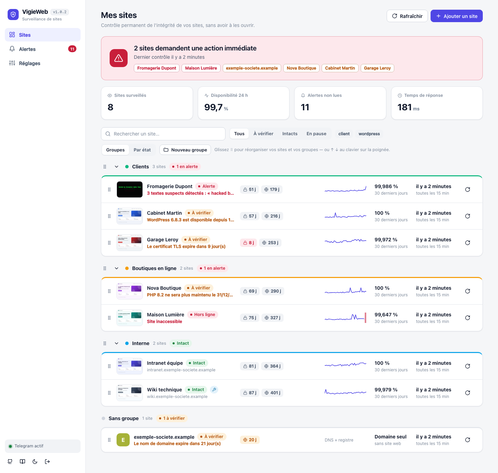

> **Toutes les images de ce document utilisent des données fictives** (domaines en `.example`, adresses IP de documentation) : elles sont générées par le [mode démo](#essayer-sans-rien-configurer-mode-démo), jamais à partir de vrais sites.

## Sommaire

[Aperçu](#aperçu) · [Démarrage](#démarrage) · [Déploiement sur Dokploy](#déploiement-sur-dokploy-docker) · [Telegram](#configurer-telegram) · [Captures d'écran](#captures-décran) · [Groupes](#groupes-de-sites) · [Ce qui est surveillé](#ce-qui-est-surveillé) · [WordPress et PrestaShop](#wordpress-et-prestashop) · [Réduire le bruit](#réduire-le-bruit) · [Limites](#limites-à-connaître) · [Architecture](#architecture) · [Mode démo](#essayer-sans-rien-configurer-mode-démo)

## Aperçu

### La page d'un site

Un coup d'œil suffit : l'**aperçu** de la page (dernière capture), l'état HTTP, le temps de réponse, la disponibilité sur 30 jours, la frise des 90 derniers jours, puis chaque **signal surveillé** (contenu, certificat TLS, DNS, nom de domaine, serveur et redirections) avec son état.

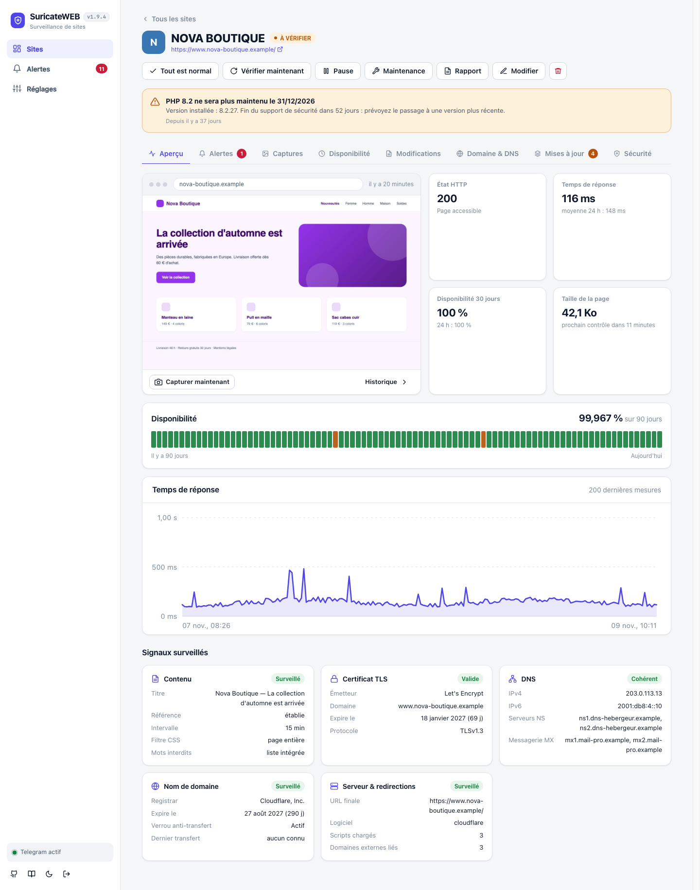

### Détecter une défiguration

Quand le contenu est remplacé, VigieWeb le dit clairement (**similarité 0 %**), montre les lignes retirées et ajoutées, et garde chaque version : on peut toujours revenir voir ce qui a changé et quand.

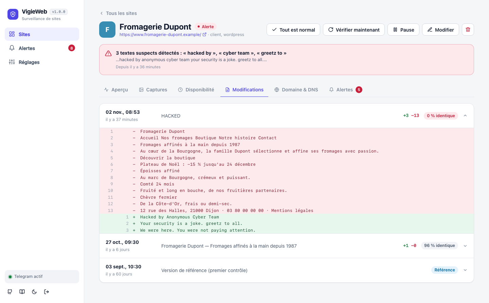

Les **captures d'écran** régulières montrent ce que voient réellement les visiteurs, et la visionneuse permet de **comparer avant / après** côte à côte.

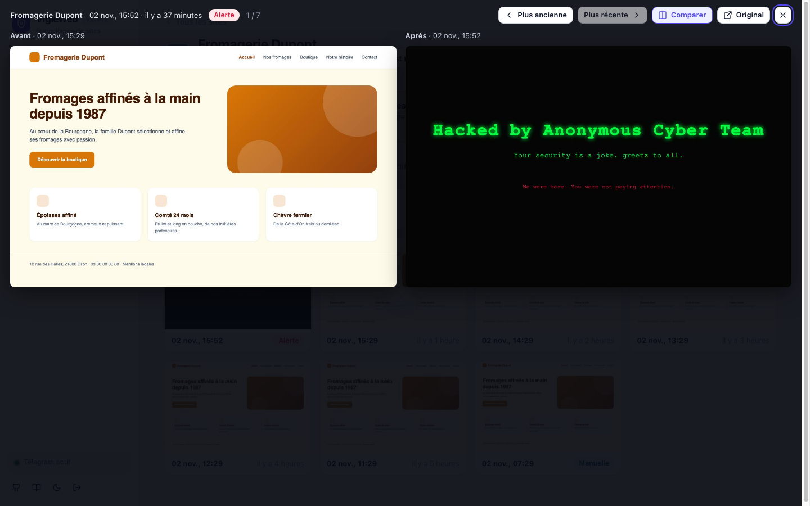

### Être alerté sur Telegram

Un seul message par contrôle, avec la sévérité, le détail, un extrait des lignes modifiées et, pour les alertes critiques visibles sur la page, **une photo de la page au moment de l'alerte**. Le texte de cette image est celui que l'application génère ; seul l'habillage de la conversation est une reconstitution.

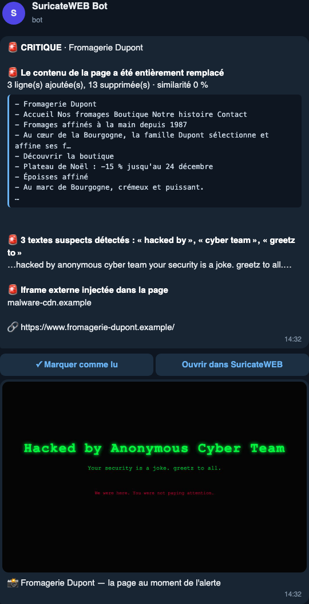

### Disponibilité, domaine et alertes

| Disponibilité (type UptimeRobot) | Domaine & DNS |
|---|---|
| 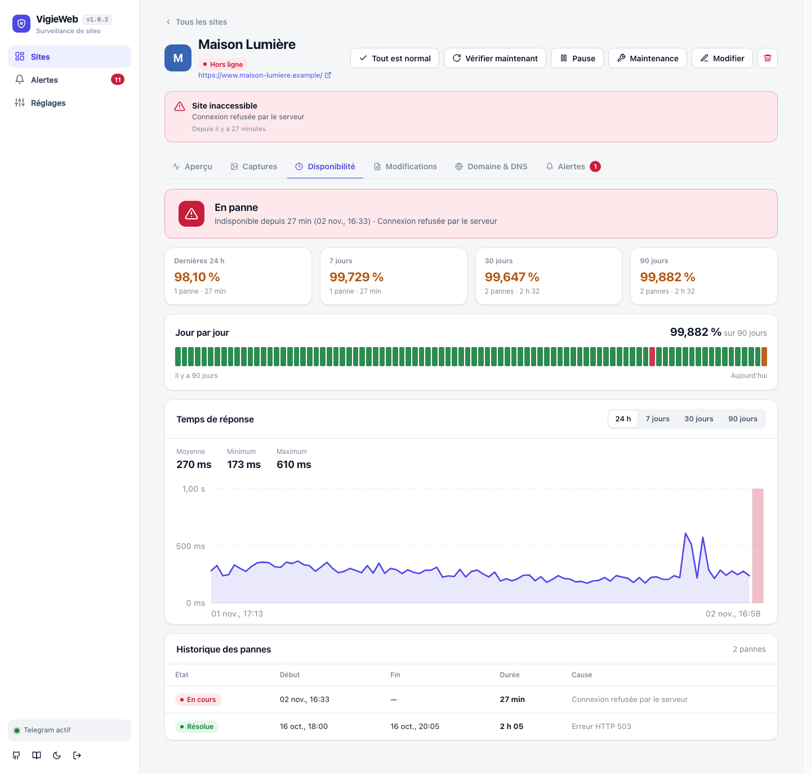 | 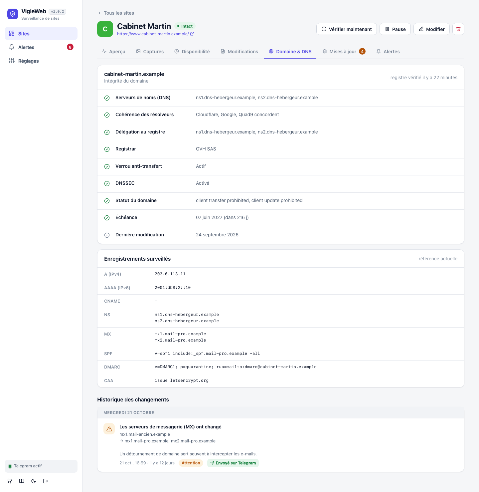 |

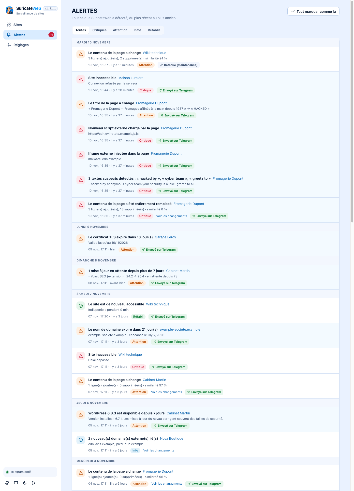

### Thème sombre et mobile

L'interface suit le thème du système (bouton lune / soleil dans la barre latérale) et s'adapte aux petits écrans : la barre latérale devient une barre de navigation en bas.

| Thème sombre | Mobile |
|---|---|
| 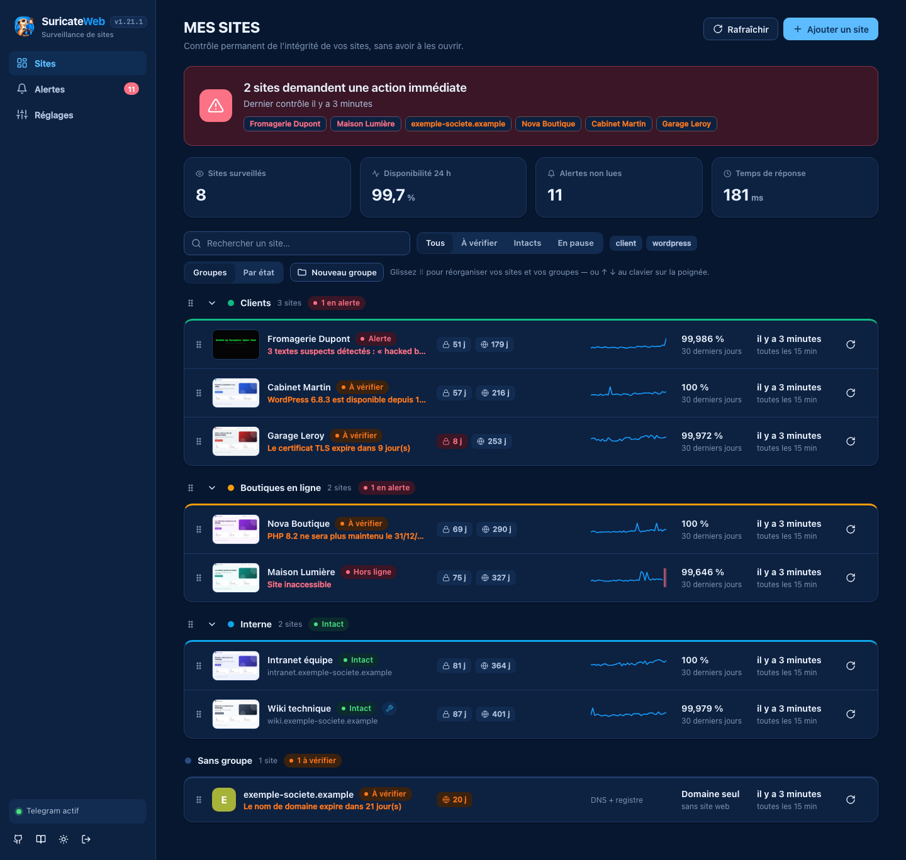 | 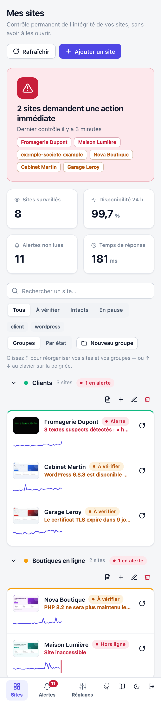 |

### Barre latérale

Sous le nom **VigieWeb**, la **version de l'application** (lue dans `package.json`). En bas, à côté du thème et de la déconnexion : un lien vers le **dépôt GitHub** et un lien vers la **documentation** (ce README). Ces liens s'ouvrent dans un nouvel onglet ; ils proviennent des champs `repository` et `homepage` de `package.json`, et disparaissent s'ils n'y sont pas renseignés.

## Démarrage

Prérequis : Node.js ≥ 22.13 (et Chrome/Chromium pour les [captures d'écran](#captures-décran), facultatif).

```bash
cp .env.example .env     # puis éditez VIGIE_USER et VIGIE_PASSWORD
npm start
```

Ouvrez <http://localhost:3000>, connectez-vous, cliquez sur **Ajouter un site**, puis configurez Telegram dans **Réglages**.

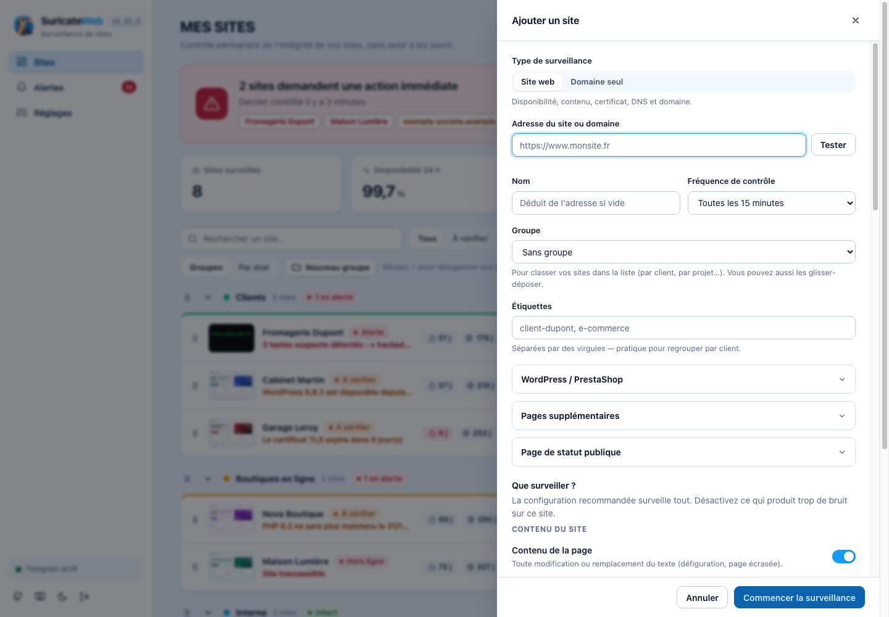

Dans le formulaire, le bouton **Tester** vérifie l'adresse avant de l'enregistrer. La configuration recommandée surveille tout ; désactivez ce qui produit trop de bruit sur un site donné.

### Connexion : identifiant et mot de passe dans `.env`

**L'application est toujours protégée.** Les identifiants se définissent uniquement dans le fichier `.env` (ou dans les variables d'environnement de l'hébergeur) ; rien n'est modifiable depuis l'interface, et **VigieWeb refuse de démarrer** s'ils sont absents.

```ini
VIGIE_USER=admin
VIGIE_PASSWORD="un mot de passe solide"     # 8 caractères minimum ; guillemets si il contient # ou des espaces
```

- Générer un mot de passe : `node -e "console.log(require('crypto').randomBytes(18).toString('base64url'))"`
- Changer d'identifiants : modifiez le `.env`, redémarrez. **Toutes les sessions ouvertes sont alors déconnectées.**
- Si `VIGIE_USER` est absent, l'identifiant par défaut est `admin` (avertissement au démarrage).
- Les variables déjà définies dans l'environnement (Docker, Dokploy) **ont priorité** sur le `.env`.
- `.env` est ignoré par Git et par Docker : il ne sera jamais versionné ni copié dans une image.
- 5 tentatives de connexion par minute et par IP ; le mot de passe n'apparaît jamais dans les journaux.

| Variable | Défaut | Rôle |
|---|---|---|
| `VIGIE_USER` | `admin` | Identifiant de connexion |
| `VIGIE_PASSWORD` | — (**obligatoire**) | Mot de passe de connexion |
| `PORT` | `3000` | Port d'écoute |
| `HOST` | `127.0.0.1` | Interface d'écoute (`0.0.0.0` pour exposer sur le réseau) |
| `DATA_DIR` | `./data` | Base SQLite et captures d'écran |
| `TRUST_PROXY` | — | `1` derrière un reverse proxy (cookie `Secure`, IP client) |
| `CHROME_PATH` | détecté | Chemin de Chrome/Chromium pour les captures |
| `CHROME_NO_SANDBOX` | — | `1` dans Docker (déjà défini dans l'image) |
| `SCREENSHOT_CONCURRENCY` | `2` | Captures simultanées au maximum |
| `ENV_FILE` | `./.env` | Emplacement alternatif du fichier d'environnement |
| `TELEGRAM_API` | `https://api.telegram.org` | Adresse de l'API Telegram (utile pour les tests ou un relais) |
| `VIGIE_DEMO` | — | `1` : [mode démo](#essayer-sans-rien-configurer-mode-démo), contrôles et captures désactivés |

> **Placez VigieWeb derrière HTTPS** (reverse proxy) si vous l'exposez hors de votre machine : le mot de passe transite sinon en clair. Un utilisateur connecté peut faire requêter des adresses arbitraires par le serveur : ne partagez pas l'accès.

Pour le laisser tourner en continu : `pm2 start server.js --name vigieweb --node-args="--disable-warning=ExperimentalWarning"`, ou un service systemd (`ExecStart=/usr/bin/node --disable-warning=ExperimentalWarning server.js`).

### Essayer sans rien configurer (mode démo)

```bash
npm run demo
```

Ouvrez <http://127.0.0.1:3100> (identifiant `demo`, mot de passe `demo-password`) : VigieWeb démarre avec **des sites, des alertes, des pannes et des captures fictifs**, dans un dossier temporaire supprimé à l'arrêt. Aucune donnée de `./data` n'est touchée. En mode démo, les contrôles et les captures sont désactivés (un clic sur « Vérifier maintenant » l'indique), et aucune requête n'est envoyée vers l'extérieur ; Telegram n'est pas configuré.

Les images de ce document sont produites par le même jeu de données :

```bash
npm run docs:screenshots     # régénère docs/screenshots/*.png (nécessite Chrome ou Chromium)
```

## Déploiement sur Dokploy (Docker)

Le `Dockerfile` à la racine produit une image d'environ **1,3 Go** (Node 24 Alpine + Chromium et ses polices pour les captures), avec `tini` et un healthcheck. Le processus Node tourne sans droits root ; au démarrage, l'image rend d'abord le volume de données accessible à l'utilisateur `node`.

1. **Créer l'application** : *Create Application* → source Git (ou dépôt public) → *Build Type* : **Dockerfile**.
2. **Variables d'environnement** (onglet *Environment*) :

   | Variable | Valeur | Rôle |
   |---|---|---|
   | `VIGIE_USER` | l'identifiant de votre choix | Identifiant de connexion (`admin` si absent) |
   | `VIGIE_PASSWORD` | un mot de passe de 8+ caractères | **Obligatoire** : sans lui, le conteneur s'arrête avec un message explicite dans les journaux |
   | `TRUST_PROXY` | `1` (déjà dans l'image) | Lit `X-Forwarded-*` de Traefik : cookie `Secure` en HTTPS, vraie IP pour la limitation des tentatives de connexion |

   Chromium (`CHROME_PATH`, `CHROME_NO_SANDBOX`) est déjà configuré dans l'image.

3. **Volume persistant** (onglet *Advanced › Volumes*) : type **Volume**, nom `vigie-data` (nom libre : gardez celui que vous avez déjà créé), chemin de montage `/data`. Sans lui, la base (sites, historique, jeton Telegram) **et les captures d'écran** sont perdues à chaque redéploiement.
   Un volume créé par Dokploy appartient souvent à root : l'image corrige ça au démarrage (`unable to open database file` venait de là). Le chemin de montage doit rester `/data`, ou correspondre à `DATA_DIR` si vous le changez.
4. **Domaine** (onglet *Domains*) : votre domaine, **port `3000`**, HTTPS activé (Let's Encrypt).
5. **Déployer.**

Notes :
- Ne lancez qu'**une seule instance** : la base SQLite et le planificateur ne sont pas conçus pour tourner en double.
- Les contrôles partent du serveur Dokploy : pour surveiller un site, celui-ci doit être joignable depuis ce serveur (un site restreint par IP doit autoriser son adresse).
- Sauvegarde : le dossier `/data` contient tout ; sinon *Réglages › Données › Exporter* sauvegarde la liste des sites, leurs groupes et leur configuration (pas l'historique).
- L'image ne contient que le code de l'application : les scripts de démo, les tests et les captures de ce README n'y sont pas copiés.

Hors Dokploy, la même image fonctionne partout :

```bash
docker build -t vigieweb .
docker run -d --name vigieweb -p 3000:3000 -v vigie-data:/data \
  -e VIGIE_USER=admin -e VIGIE_PASSWORD='un-mot-de-passe-solide' vigieweb
```

## Configurer Telegram

1. Dans Telegram, ouvrez **@BotFather**, envoyez `/newbot`, copiez le jeton.
2. Collez-le dans *Réglages › Notifications Telegram*, puis envoyez `/start` à votre bot (ou ajoutez-le dans un groupe).
3. Cliquez sur **Détecter** (retrouve le chat ID tout seul), puis **Tester**, puis **Enregistrer**.

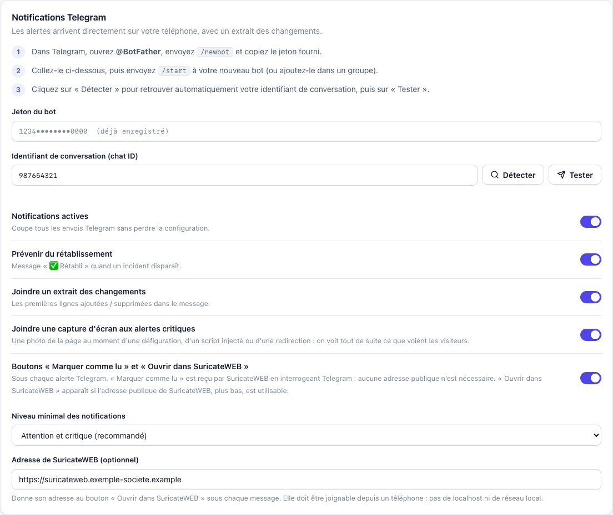

Les options : notifications actives (coupe tous les envois sans perdre la configuration), message de **rétablissement**, **extrait des changements**, **capture d'écran jointe aux alertes critiques**, **niveau minimal** des notifications (« Attention et critique » par défaut) et **adresse de VigieWeb** (ajoute un lien « Ouvrir dans VigieWeb » à chaque message). Le jeton, une fois enregistré, n'est plus renvoyé au navigateur qu'abrégé (`1234••••0000`). La section *Détection* des Réglages fixe la fréquence et le User-Agent par défaut et la liste des mots-clés suspects ; *Données* exporte et importe la liste des sites.

Un seul message est envoyé par contrôle, même si plusieurs anomalies sont détectées. Il contient la sévérité, le site, le détail et un extrait des lignes modifiées.

Sur une alerte **critique visible sur la page** (contenu remplacé, texte de piratage, script ou iframe injectés, redirection vers un autre domaine…), le message est suivi d'une **photo de la page au moment de l'alerte** : on voit depuis le téléphone ce que voient les visiteurs. Désactivable dans *Réglages › Telegram*. Les alertes sans effet visible (DNS, registre, certificat, panne) n'en envoient pas.

Dans l'application, l'onglet **Alertes** liste tout ce qui a été détecté (filtres Critiques / Attention / Infos / Rétablis, « Voir les changements » pour ouvrir le diff, badge « Envoyé sur Telegram »). **Tout marquer comme lu** efface le badge ; sur la page d'un site, **Tout est normal** marque ses alertes comme vérifiées.

## Captures d'écran

VigieWeb prend une photo de chaque site à intervalle régulier (**toutes les heures par défaut**, de 5 minutes à 7 jours) :

- **Aperçu immédiat** : la dernière capture s'affiche dans un cadre de navigateur en haut de la page du site, et en vignette dans la liste.
- **Onglet Captures** : l'historique en grille, une visionneuse (flèches ← →), et une **comparaison côte à côte avant / après** pour constater une défiguration.
- Réglable par site : fréquence, format (ordinateur 1280×800, grand écran 1920×1080, mobile 390×844), page entière (5 000 px maximum), attente après chargement, simulation de visiteur, masquage des bandeaux de cookies. Bouton **Capturer maintenant**.

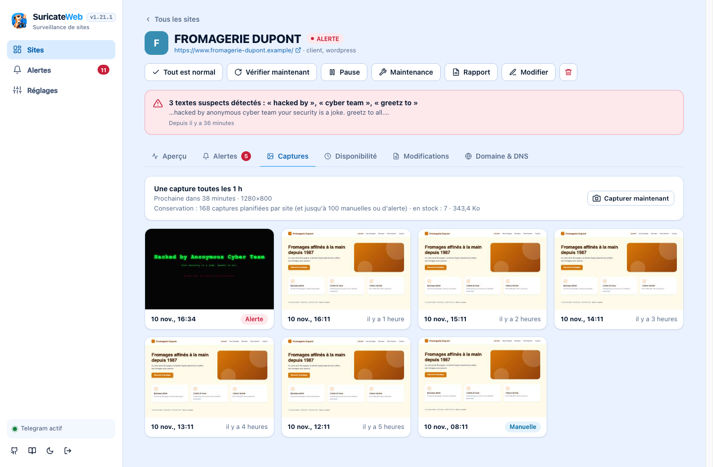

**Avant de capturer, VigieWeb se comporte comme un visiteur** : il attend que le réseau soit au repos, simule une interaction (souris, molette), descend la page par paliers pour déclencher le chargement différé des images et les animations « à l'apparition », la remonte, attend les polices, puis patiente (3 s par défaut). Cela évite les captures à moitié vides.

> Pourquoi la simulation de visiteur ? Beaucoup de sites WordPress (WP Rocket « retarder l'exécution du JavaScript », NitroPack, Perfmatters…) **n'exécutent leurs scripts qu'à la première interaction réelle** d'un visiteur. Sans elle, jQuery, le slider d'accueil ou les menus ne démarrent jamais, et la capture montre des zones vides — y compris si on attend 6 secondes de plus, ce qui a été constaté sur un site réel. Contrepartie : ces scripts retardés incluent souvent vos **statistiques** (Google Analytics, Matomo, pixels) ; chaque capture peut donc compter une visite. Désactivez « Simuler un visiteur » pour un site dont ce n'est pas souhaitable, ou excluez l'IP du serveur de vos statistiques.

- Conservation : les 168 dernières captures planifiées par site (7 jours à l'heure), plus 100 captures manuelles ou d'alerte, qui ne sont jamais écrasées par les planifiées. Une miniature de ~5 Ko évite d'alourdir le tableau de bord.
- Les images restent derrière la connexion : aucun lien de capture n'est public.

Le navigateur est piloté directement par le protocole DevTools de Chrome : **aucune dépendance npm**. Il faut Chrome, Chromium, Edge ou Brave sur le serveur (détecté automatiquement, ou `CHROME_PATH`) ; l'image Docker embarque Chromium. Sans navigateur, tout le reste fonctionne et l'interface l'indique.

Chaque capture lance un navigateur neuf avec un profil jetable, puis le détruit : pas de cookies qui s'accumulent, pas de processus orphelin. Les fenêtres `alert()` sont ignorées. **La page est réellement exécutée** (JavaScript compris) : si un site est piraté, son code malveillant s'exécute dans ce navigateur. Il tourne dans le conteneur, sous un utilisateur sans privilèges, et ne conserve rien après la capture. Dans Docker, le bac à sable interne de Chrome est désactivé (`--no-sandbox`, impossible sans privilèges) : l'isolation est celle du conteneur. Si ce risque ne vous convient pas, désactivez les captures site par site (*Modifier › Capture d'écran*).

## Groupes de sites

La liste des sites peut être organisée en **groupes nommés et colorés** (par client, par projet, par environnement…), réorganisables à volonté (voir le [tableau de bord](#vigieweb) en haut de cette page).

- **Glisser-déposer** : attrapez la poignée ⠿ à gauche d'un site pour le déplacer dans son groupe, vers un autre groupe (même vide ou replié) ou vers « Sans groupe » ; attrapez celle d'un groupe pour changer l'ordre des groupes. Une ligne bleue indique où le site va tomber.
- **Au clavier** : placez le focus sur une poignée, puis **↑ / ↓** pour déplacer d'un cran. Un site franchit la frontière du groupe voisin ; le focus le suit et un lecteur d'écran annonce « position 2 sur 3, groupe Clients ».
- **Chaque en-tête de groupe** affiche le nombre de sites et l'état le plus grave (« 2 en alerte », « Intact »), se replie d'un clic (état mémorisé), et propose `+` (ajouter un site dans ce groupe), ✎ (renommer, changer la couleur) et 🗑 (supprimer). Ces trois actions apparaissent au survol, et en permanence sur écran tactile.
- **Supprimer un groupe ne supprime jamais ses sites** : ils passent dans « Sans groupe », à la suite et dans leur ordre.
- Le champ **Groupe** du formulaire d'un site permet aussi de classer (et de créer un groupe à la volée) : c'est l'alternative sur écran tactile, où le glisser-déposer natif n'existe pas.
- La vue **Par état** (bouton en haut de la liste) remet la liste à plat, sites en alerte en premier, avec le groupe de chaque site en pastille. Le choix est mémorisé dans le navigateur.
- Pendant une **recherche ou un filtre** (état, étiquette), la réorganisation est désactivée (des sites sont cachés : le résultat serait ambigu) et les groupes repliés se déplient pour ne rien cacher.
- Chaque déplacement est appliqué tout de suite à l'écran, puis enregistré **en une seule transaction** côté serveur (tout ou rien) ; en cas d'échec, l'état réel est rechargé.
- L'**export / import** conserve les groupes (par leur nom, couleur comprise) ; un groupe existant du même nom est réutilisé. Un ancien export sans groupes s'importe comme avant.

## Ce qui est surveillé

**Contenu du site**

| Signal | Détecte |
|---|---|
| Contenu de la page | Modification du texte ; **remplacement total** (similarité < 25 %) classé critique ; page quasi vide |
| Mots-clés suspects | « hacked by », pages par défaut nginx/Apache, « domaine à vendre », compte suspendu, spam pharmaceutique/casino… (liste modifiable) |
| Textes obligatoires / interdits | Vos propres mots-clés par site |
| Titre | Changement de `<title>` |
| Scripts | Nouveau fichier JS (externe = critique) ; JS obfusqué (`eval(atob…)`, packers…) |
| Liens, iframes, formulaires | Iframe externe injectée, formulaire détourné vers un autre domaine, `meta refresh`, nouveaux domaines liés (spam SEO) |

**Redirections** — redirection vers un autre domaine, retour en HTTP non chiffré, changement du logiciel serveur.

**Certificat TLS** — invalide, expiré, expiration proche, changement d'émetteur (critique) ou simple renouvellement (info).

Chaque version du contenu est conservée (les 300 dernières par site) et comparable à la précédente dans l'onglet **Modifications**.

### Disponibilité (type UptimeRobot)

Un site est **en panne** s'il ne répond pas ou renvoie une vraie erreur HTTP (5xx, 404…). Les accès restreints (401, 403, 429) comptent comme « joignable ». La panne est **confirmée** après N échecs consécutifs (2 par défaut, réglable) pour éviter les fausses alertes, mais elle est **datée du premier échec**.

- **Disponibilité sur 24 h, 7, 30 et 90 jours**, calculée **en temps** à partir de la durée réelle des pannes : elle reste exacte quelle que soit la fréquence de contrôle (de 1 minute à 24 heures).
- **Frise de 90 jours** (une barre par jour : vert, ambre, rouge) et **historique des pannes** (début, fin, durée, cause).
- **Temps de réponse** moyen / min / max sur 24 h, 7, 30 et 90 jours.
- Alerte « Site inaccessible », puis « ✅ Le site est de nouveau accessible — indisponible pendant 12 min ».
- Mettre un site en pause clôt une panne en cours : la pause ne compte pas comme indisponibilité.

Les agrégats journaliers sont conservés ~13 mois ; seul le détail des contrôles est purgé (10 000 derniers par site).

### Détournement de domaine, transfert et DNS

Onglet **Domaine & DNS** de chaque site, ou type **Domaine seul** pour un nom sans site web (messagerie, nom réservé) : aucune requête HTTP, uniquement DNS et registre.

| Signal | Sévérité | Pourquoi c'est un signe de détournement |
|---|---|---|
| Serveurs de noms (NS) changés | critique | Le plus classique : le pirate délègue la zone à ses propres serveurs |
| **Délégation au registre** changée (RDAP) | critique | La source officielle : change immédiatement, sans cache DNS |
| **Registrar** changé / transfert enregistré | critique | Le domaine a quitté votre registrar |
| Statut **« pending transfer »**, « hold », « redemption », « pending delete » | critique | Transfert en cours, domaine suspendu ou en cours de suppression |
| **DNSSEC désactivé** | critique | Retiré lors de nombreux détournements de zone |
| Verrou anti-transfert retiré | attention | Préalable à un transfert non autorisé |
| Résolveurs publics en désaccord (Cloudflare, Google, Quad9) | attention | Propagation d'un changement, ou détournement / cache empoisonné |
| MX, SPF, DMARC changés | attention | Interception ou usurpation des e-mails |
| CNAME, CAA changés | attention | Redirection du site ; autorisation d'un autre émetteur de certificats |
| Adresse IP : plage jamais vue | attention | Nouvel hébergeur (les rotations de CDN sont ignorées) |
| Échéance du domaine < 30 j, puis < 7 j | attention / critique | Expiration = perte du domaine |
| Date de dernière modification au registre | info | Pour l'historique |

Le registre est interrogé **toutes les heures** (une seule requête par domaine, même si plusieurs sites le partagent) ; le DNS à chaque contrôle.

> Le détournement DNS d'un domaine dont les NS restent les mêmes mais dont les enregistrements A sont modifiés chez l'hébergeur DNS est détecté par le changement de plage d'IP et le changement de CNAME, pas par les NS.

Deux familles d'alertes : les **incidents** (état anormal persistant : une alerte à l'apparition, un message « ✅ Rétabli » à la disparition, jamais de répétition) et les **évènements** (changement ponctuel : la nouvelle valeur devient la référence).

Le premier contrôle établit la référence et ne déclenche aucune alerte de changement.

## Réduire le bruit

- **Sélecteur CSS** (`main`, `#contenu`, `.article > p`) pour ne comparer qu'une zone ; **exclusion** (`.horloge, .pub`).
- **Expressions régulières** pour ignorer des lignes (compteurs, dates).
- **Seuil de modification** (%) et **niveau minimal de notification** (global ou par site).
- Désactivez individuellement chaque famille de contrôle sur un site donné.

## Limites à connaître

- **La comparaison de contenu lit le HTML tel que le serveur le renvoie**, sans l'exécuter. Le contenu généré uniquement par JavaScript (SPA) n'est pas comparé (la capture d'écran, elle, l'affiche), mais DNS, TLS, RDAP, redirections et scripts restent surveillés.
- **Le cloaking** (un site piraté qui montre une page saine aux robots) peut passer entre les mailles ; changez le User-Agent par site si vous le suspectez.
- **RDAP** dépend du registre de l'extension ; certains (dont `.fr`) n'exposent pas le verrou de transfert : l'interface l'indique plutôt que d'afficher « absent ».
- **La disponibilité est mesurée depuis votre serveur VigieWeb.** Une panne réseau de ce serveur peut apparaître comme une panne du site, et un site injoignable seulement depuis certains pays n'est pas vu. Pour plus de fiabilité, hébergez VigieWeb ailleurs que les sites surveillés.
- **Pas de rétroactivité** : la disponibilité n'est calculée qu'à partir de l'installation de cette fonction ; avant, les sites sont considérés disponibles.
- Les résolveurs publics (1.1.1.1, 8.8.8.8, 9.9.9.9) doivent être joignables en UDP/53 depuis le serveur ; sinon la cohérence entre résolveurs est simplement ignorée.
- Les adresses IP derrière un CDN tournent : VigieWeb ne signale un changement d'IP que si **aucune** plage déjà vue n'est reconnue.

## WordPress et PrestaShop

Pour un site WordPress ou PrestaShop, VigieWeb peut afficher la **version de PHP**, et pour le noyau, les extensions (ou modules) et les thèmes : la **version actuelle** et la **version disponible**.

Le relevé se fait **depuis le site**, là où ces informations existent. Un plugin, installé sur le site, répond uniquement à VigieWeb. Il n'envoie rien de lui-même : VigieWeb l'interroge (toutes les 12 heures par défaut, ou tout de suite avec **Actualiser**).

1. Dans la fiche du site, ouvrez **WordPress / PrestaShop**, choisissez le CMS et copiez le jeton.
2. Téléchargez le plugin (lien dans le même bloc), installez-le et activez-le.
3. Collez le jeton dans les réglages du plugin (WordPress : Réglages › VigieWeb ; PrestaShop : Modules › VigieWeb).
4. L'onglet **Mises à jour** du site affiche le relevé.

Si le CMS est dans un sous-dossier (`exemple.fr/blog`), indiquez ce dossier. L'adresse appelée est toujours celle du site surveillé.

Ce que le relevé ne peut pas inventer :

- une mise à jour de **PHP** (seule la version installée est lue) ;
- une extension WordPress **premium**, sauf si son propre système de mise à jour la déclare à WordPress ;
- un module PrestaShop **absent du catalogue Addons**, ou un thème sur mesure : la version actuelle est affichée, la version disponible reste « inconnue » ;
- le mode démo n'interroge aucun site.

Le point d'accès du plugin ne répond qu'avec le jeton et ne renvoie que des numéros de version.

## Architecture

```
server.js            API REST + fichiers statiques + SSE (temps réel) + authentification
src/checker.js       un contrôle : HTTP → pannes → contenu → DNS/TLS/RDAP → incidents/évènements → alertes
src/html.js          parseur HTML tolérant + sélecteurs CSS + extraction des signaux
src/diff.js          diff ligne à ligne (LCS)
src/telegram.js      API Bot Telegram (texte et photo) + mise en forme des messages
src/screenshot.js    captures d'écran : Chrome piloté par DevTools (WebSocket natif), file d'attente, rétention
src/auth.js          identifiants lus dans l'environnement, comparaison en temps constant, clé de session
src/env.js           chargement du .env (avant l'ouverture de la base)
src/scheduler.js     planificateur (5 contrôles en parallèle, relevés CMS à part)
src/cms.js           relevé PHP / mises à jour : appel du plugin WordPress ou PrestaShop
src/zip.js           archive ZIP sans compression, pour télécharger les plugins
src/db.js            SQLite : sites, groupes, contrôles, versions (gzip), alertes, réglages
plugins/             plugins WordPress et PrestaShop (jeton, versions, mises à jour)
public/              interface (JS/CSS vanilla, sans build)
public/layout.js     organisation en groupes : calcul pur (déplacements, pas au clavier), sans DOM, testé unitairement
test/                node --test (unitaires, API réelle, et bout en bout dans un vrai Chrome)
test-support/        lancement d'un serveur de test et pilotage de Chrome (tests et captures)
scripts/docs/        mode démo : faux sites, données fictives, génération des captures de ce README
docs/screenshots/    images de ce README (régénérables avec npm run docs:screenshots)
```

```bash
npm test
```

Les tests lancent un faux site qu'ils « piratent » en direct et un faux serveur Telegram pour vérifier les messages réellement envoyés ; les tests d'interface s'exécutent dans un vrai Chrome (ils sont ignorés si aucun navigateur n'est installé).

Scripts disponibles : `npm start`, `npm run dev` (rechargement automatique), `npm test`, `npm run demo`, `npm run docs:screenshots`.

## Nom du produit et identifiants techniques

Le produit s'appelle **VigieWeb**. Quelques identifiants techniques gardent volontairement l'ancien nom « vigie » : les renommer casserait les installations existantes ou ferait perdre des données.

| Identifiant | Pourquoi il ne change pas |
|---|---|
| `VIGIE_USER`, `VIGIE_PASSWORD`, `VIGIE_DEMO` | Variables d'environnement déjà définies dans vos déploiements (Dokploy, Docker, `.env`) |
| `vigie.db` | Fichier de la base : le renommer ferait repartir de zéro |
| cookie `vigie_session`, clé `vigie-theme` | Renommés = tout le monde est déconnecté et perd son thème |
| `vigie-data`, noms de conteneur / d'image dans les exemples | Noms libres, choisis par vous à l'installation |
| `vigie-chrome-*` | Préfixe interne des profils temporaires de Chrome |
| `vigie-sites.json` | Nom du fichier d'export, que d'anciens scripts peuvent attendre |

Dans les textes affichés (interface, messages Telegram, journaux, User-Agent), c'est toujours « VigieWeb ». Le User-Agent par défaut enregistré en base est migré automatiquement ; un User-Agent personnalisé n'est jamais modifié.

## Licence

VigieWeb est distribué sous licence **[Apache 2.0](LICENSE)** : usage, modification et redistribution libres, y compris commerciaux, à condition de conserver la licence et l'avis de copyright ([NOTICE](NOTICE)) ; la licence comprend aussi une concession de brevets et exclut toute garantie. Le projet n'a aucune dépendance npm : aucun code tiers n'est embarqué.
