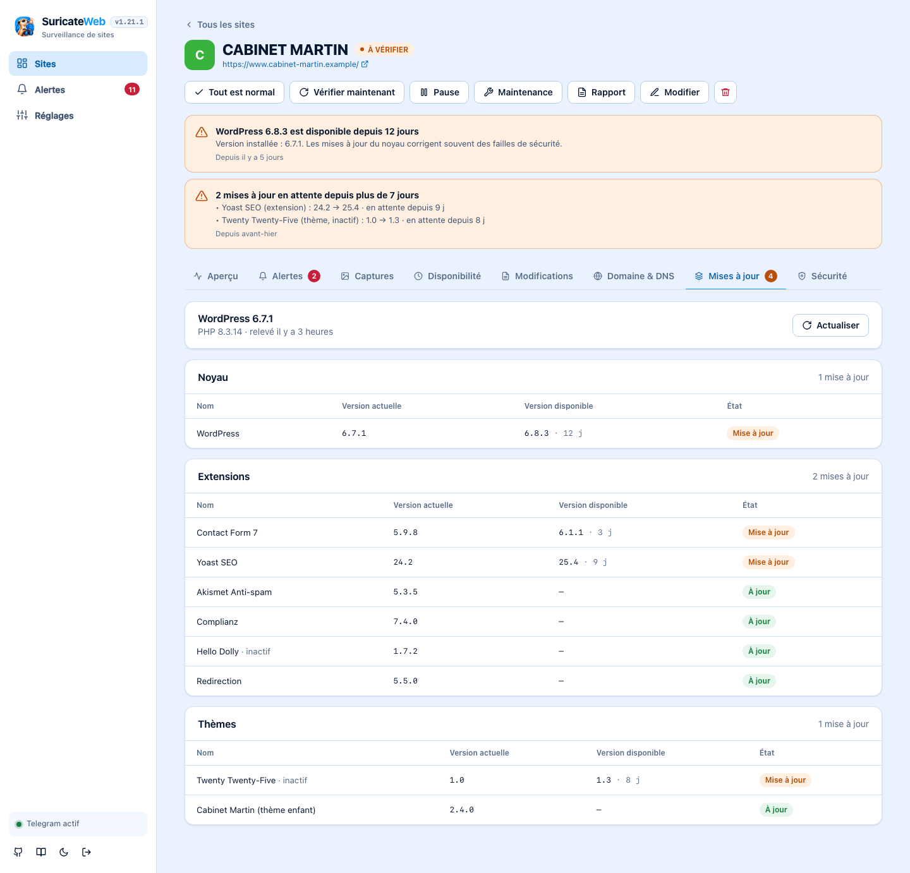
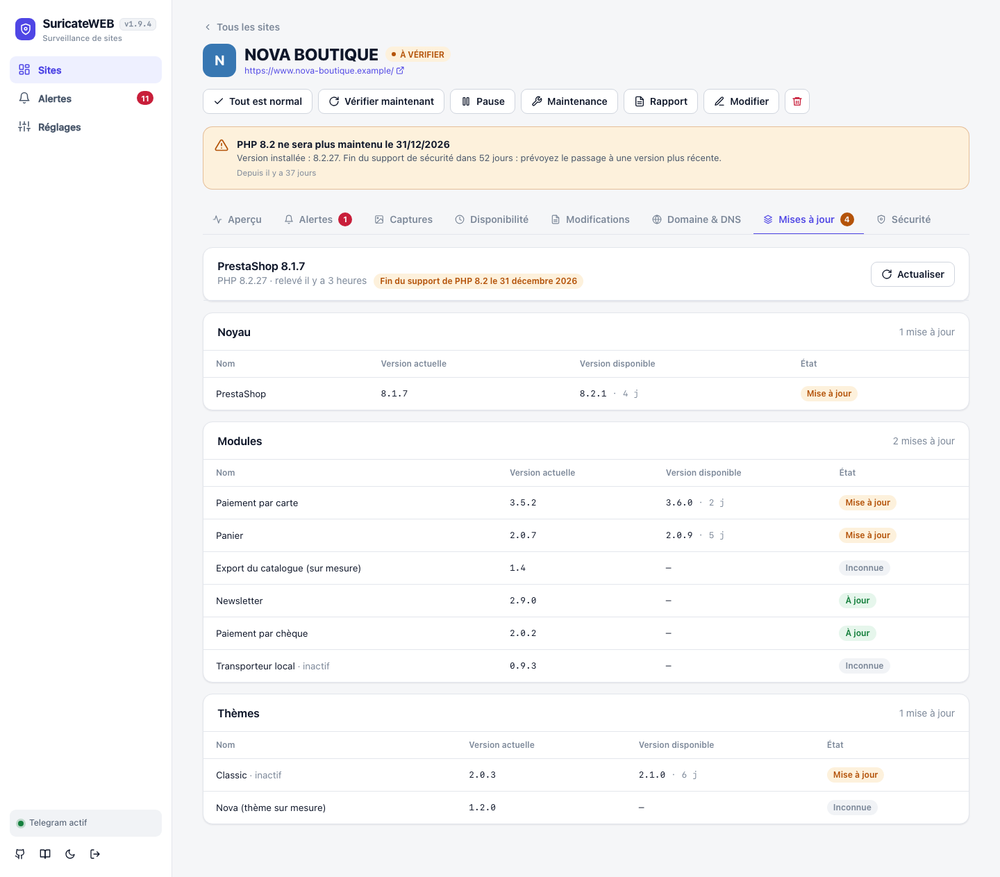
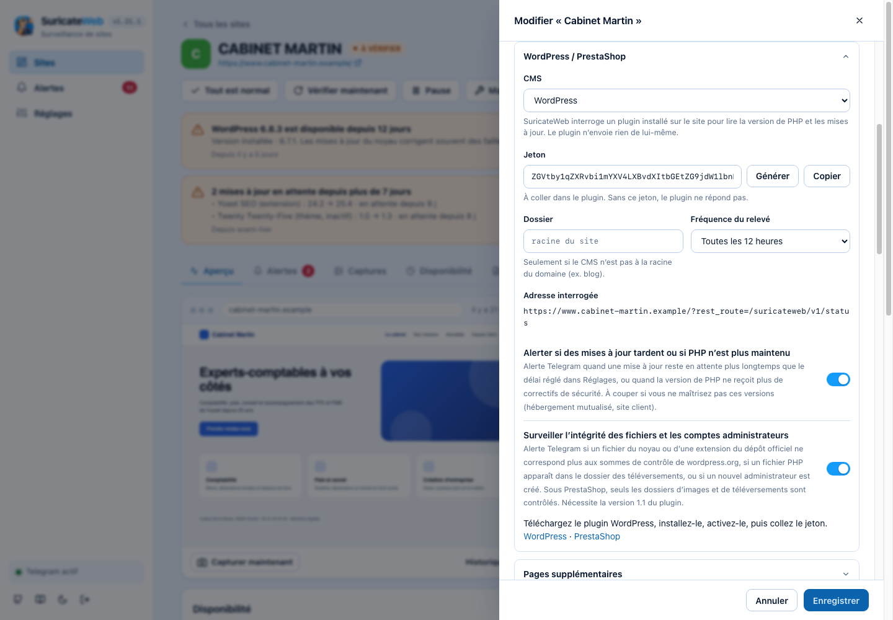
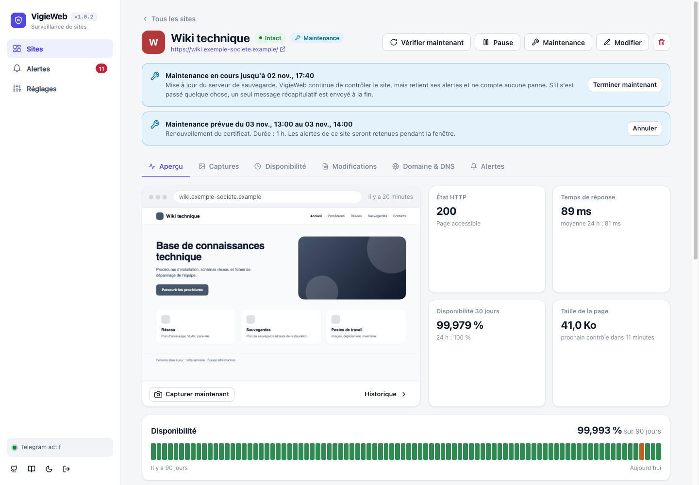
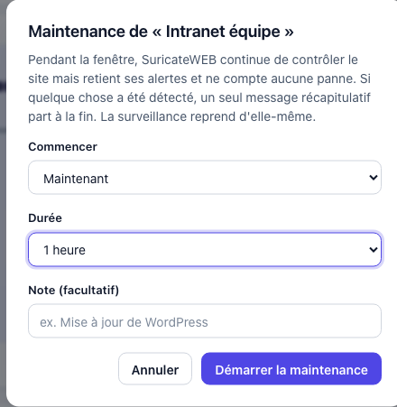

# SuricateWEB

Surveillance de sites web pour webmasters : **détecter un piratage, une défiguration, un remplacement ou un transfert de domaine sans ouvrir le site**, et être alerté sur **Telegram**.

Inspiré de [changedetection.io](https://github.com/dgtlmoon/changedetection.io), mais pensé pour la sécurité plutôt que pour le suivi de prix : en plus du contenu, SuricateWEB surveille ce qui change quand un site est compromis.

**Node.js pur — zéro dépendance npm, pas de Python.** Serveur HTTP, `fetch`, `dns`, `tls` et SQLite (`node:sqlite`) sont natifs.


> **Toutes les images de ce document utilisent des données fictives** (domaines en `.example`, adresses IP de documentation) : elles sont générées par le [mode démo](#essayer-sans-rien-configurer-mode-démo), jamais à partir de vrais sites.

## Sommaire

[Aperçu](#aperçu) · [Démarrage](#démarrage) · [Déploiement sur Dokploy](#déploiement-sur-dokploy-docker) · [Telegram](#configurer-telegram) · [Captures d'écran](#captures-décran) · [Groupes](#groupes-de-sites) · [Ce qui est surveillé](#ce-qui-est-surveillé) · [WordPress et PrestaShop](#wordpress-et-prestashop-mises-à-jour) · [Sécurité du CMS](#sécurité-du-cms-intégrité-des-fichiers-et-administrateurs) · [Plusieurs pages](#plusieurs-pages-par-site) · [Rapport et page de statut](#rapport-mensuel-et-page-de-statut) · [Réduire le bruit](#réduire-le-bruit) · [Maintenance](#fenêtres-de-maintenance) · [Limites](#limites-à-connaître) · [Architecture](#architecture) · [Mode démo](#essayer-sans-rien-configurer-mode-démo)

## Aperçu

### La page d'un site

Un coup d'œil suffit : l'**aperçu** de la page (dernière capture), l'état HTTP, le temps de réponse, la disponibilité sur 30 jours, la frise des 90 derniers jours, puis chaque **signal surveillé** (contenu, certificat TLS, DNS, nom de domaine, serveur et redirections) avec son état.


### Détecter une défiguration

Quand le contenu est remplacé, SuricateWEB le dit clairement (**similarité 0 %**), montre les lignes retirées et ajoutées, et garde chaque version : on peut toujours revenir voir ce qui a changé et quand.


Les **captures d'écran** régulières montrent ce que voient réellement les visiteurs, et la visionneuse permet de **comparer avant / après** côte à côte.


### Être alerté sur Telegram

Un seul message par contrôle, avec la sévérité, le détail, un extrait des lignes modifiées, deux **boutons** (« Marquer comme lu » et « Ouvrir dans SuricateWEB ») et, pour les alertes critiques visibles sur la page, **une photo de la page au moment de l'alerte**. Le texte de cette image est celui que l'application génère ; seul l'habillage de la conversation est une reconstitution.


### Disponibilité, domaine et alertes

| Disponibilité (type UptimeRobot) | Domaine & DNS |
|---|---|
|  |  |


### Mises à jour WordPress et PrestaShop

Pour un site WordPress ou PrestaShop, un petit plugin permet de lire la **version de PHP** et les **mises à jour disponibles** du noyau, des extensions (modules) et des thèmes, avec la version actuelle en regard de la version disponible, et prévient quand une mise à jour tarde ou que PHP n'est plus maintenu. [Mise en place, alertes et garde-fous](#wordpress-et-prestashop-mises-à-jour).



### Sécurité du CMS, pages sensibles, rapport client

- **Intégrité des fichiers WordPress** : le plugin compare le noyau et les extensions du dépôt officiel aux sommes de contrôle de wordpress.org, et repère un fichier modifié, un fichier PHP ajouté (porte dérobée) ou un fichier PHP dans `uploads/`. Alerte aussi quand un **nouvel administrateur** apparaît. [Détails](#sécurité-du-cms-intégrité-des-fichiers-et-administrateurs).
- **Plusieurs pages par site** : panier, connexion, contact… surveillés pour les scripts, iframes, formulaires détournés et textes suspects. [Détails](#plusieurs-pages-par-site).
- **Rapport mensuel client** (disponibilité, incidents, mises à jour, à imprimer ou enregistrer en PDF) et **page de statut** publique en lecture seule. [Détails](#rapport-mensuel-et-page-de-statut).

### Thème sombre et mobile

L'interface suit le thème du système (bouton lune / soleil dans la barre latérale) et s'adapte aux petits écrans : la barre latérale devient une barre de navigation en bas. Sur téléphone, les onglets d'un site défilent : un dégradé et une flèche indiquent qu'il en reste, et l'onglet ouvert est toujours amené à l'écran.

| Thème sombre | Mobile |
|---|---|
|  |  |

### Barre latérale

Sous le nom **SuricateWEB**, la **version de l'application** (lue dans `package.json`). En bas, à côté du thème et de la déconnexion : un lien vers le **dépôt GitHub** et un lien vers la **documentation** (ce README). Ces liens s'ouvrent dans un nouvel onglet ; ils proviennent des champs `repository` et `homepage` de `package.json`, et disparaissent s'ils n'y sont pas renseignés.

## Démarrage

Prérequis : Node.js ≥ 22.13 (et Chrome/Chromium pour les [captures d'écran](#captures-décran), facultatif).

```bash
cp .env.example .env     # puis éditez SURICATE_USER et SURICATE_PASSWORD
npm start
```

Ouvrez <http://localhost:3000>, connectez-vous, cliquez sur **Ajouter un site**, puis configurez Telegram dans **Réglages**.


Dans le formulaire, le bouton **Tester** vérifie l'adresse avant de l'enregistrer. La configuration recommandée surveille tout ; désactivez ce qui produit trop de bruit sur un site donné.

### Connexion : identifiant et mot de passe dans `.env`

**L'application est toujours protégée.** Les identifiants se définissent uniquement dans le fichier `.env` (ou dans les variables d'environnement de l'hébergeur) ; rien n'est modifiable depuis l'interface, et **SuricateWEB refuse de démarrer** s'ils sont absents.

```ini
SURICATE_USER=admin
SURICATE_PASSWORD="un mot de passe solide"     # 8 caractères minimum ; guillemets si il contient # ou des espaces
```

- Générer un mot de passe : `node -e "console.log(require('crypto').randomBytes(18).toString('base64url'))"`
- Changer d'identifiants : modifiez le `.env`, redémarrez. **Toutes les sessions ouvertes sont alors déconnectées.**
- Si `SURICATE_USER` est absent, l'identifiant par défaut est `admin` (avertissement au démarrage).
- Les variables déjà définies dans l'environnement (Docker, Dokploy) **ont priorité** sur le `.env`.
- `.env` est ignoré par Git et par Docker : il ne sera jamais versionné ni copié dans une image.
- 5 tentatives de connexion par minute et par IP ; le mot de passe n'apparaît jamais dans les journaux.

| Variable | Défaut | Rôle |
|---|---|---|
| `SURICATE_USER` | `admin` | Identifiant de connexion |
| `SURICATE_PASSWORD` | — (**obligatoire**) | Mot de passe de connexion |
| `PORT` | `3000` | Port d'écoute |
| `HOST` | `127.0.0.1` | Interface d'écoute (`0.0.0.0` pour exposer sur le réseau) |
| `DATA_DIR` | `./data` | Base SQLite et captures d'écran |
| `TRUST_PROXY` | — | `1` derrière un reverse proxy (cookie `Secure`, IP client) |
| `CHROME_PATH` | détecté | Chemin de Chrome/Chromium pour les captures |
| `CHROME_NO_SANDBOX` | — | `1` dans Docker (déjà défini dans l'image) |
| `SCREENSHOT_CONCURRENCY` | `2` | Captures simultanées au maximum |
| `ENV_FILE` | `./.env` | Emplacement alternatif du fichier d'environnement |
| `TELEGRAM_API` | `https://api.telegram.org` | Adresse de l'API Telegram (utile pour les tests ou un relais) |
| `TELEGRAM_POLL` | — | `0` : n'écoute pas les clics sur les boutons Telegram (voir [Boutons sous les alertes](#boutons-sous-les-alertes)) |
| `SURICATE_DEMO` | — | `1` : [mode démo](#essayer-sans-rien-configurer-mode-démo), contrôles et captures désactivés |

> **Placez SuricateWEB derrière HTTPS** (reverse proxy) si vous l'exposez hors de votre machine : le mot de passe transite sinon en clair. Un utilisateur connecté peut faire requêter des adresses arbitraires par le serveur : ne partagez pas l'accès.

Pour le laisser tourner en continu : `pm2 start server.js --name suricateweb --node-args="--disable-warning=ExperimentalWarning"`, ou un service systemd (`ExecStart=/usr/bin/node --disable-warning=ExperimentalWarning server.js`).

### Essayer sans rien configurer (mode démo)

```bash
npm run demo
```

Ouvrez <http://127.0.0.1:3100> (identifiant `demo`, mot de passe `demo-password`) : SuricateWEB démarre avec **des sites, des alertes, des pannes et des captures fictifs**, dans un dossier temporaire supprimé à l'arrêt. Aucune donnée de `./data` n'est touchée. Les relevés de mises à jour de « Cabinet Martin » (WordPress) et « Nova Boutique » (PrestaShop) sont fictifs, et « Wiki technique » est en maintenance. En mode démo, les contrôles, les captures et les relevés sont désactivés (un clic sur « Vérifier maintenant » l'indique), et aucune requête n'est envoyée vers l'extérieur ; Telegram n'est pas configuré.

Les images de ce document sont produites par le même jeu de données :

```bash
npm run docs:screenshots     # régénère docs/screenshots/*.png (nécessite Chrome ou Chromium)
```

## Déploiement sur Dokploy (Docker)

Le `Dockerfile` à la racine produit une image d'environ **1,3 Go** (Node 24 Alpine + Chromium et ses polices pour les captures), avec `tini` et un healthcheck. Le processus Node tourne sans droits root ; au démarrage, l'image rend d'abord le volume de données accessible à l'utilisateur `node`.

1. **Créer l'application** : *Create Application* → source Git (ou dépôt public) → *Build Type* : **Dockerfile**.
2. **Variables d'environnement** (onglet *Environment*) :

   | Variable | Valeur | Rôle |
   |---|---|---|
   | `SURICATE_USER` | l'identifiant de votre choix | Identifiant de connexion (`admin` si absent) |
   | `SURICATE_PASSWORD` | un mot de passe de 8+ caractères | **Obligatoire** : sans lui, le conteneur s'arrête avec un message explicite dans les journaux |
   | `TRUST_PROXY` | `1` (déjà dans l'image) | Lit `X-Forwarded-*` de Traefik : cookie `Secure` en HTTPS, vraie IP pour la limitation des tentatives de connexion |

   Chromium (`CHROME_PATH`, `CHROME_NO_SANDBOX`) est déjà configuré dans l'image.

3. **Volume persistant** (onglet *Advanced › Volumes*) : type **Volume**, nom `suricate-data` (nom libre : gardez celui que vous avez déjà créé), chemin de montage `/data`. Sans lui, la base (sites, historique, jeton Telegram) **et les captures d'écran** sont perdues à chaque redéploiement.
   Un volume créé par Dokploy appartient souvent à root : l'image corrige ça au démarrage (`unable to open database file` venait de là). Le chemin de montage doit rester `/data`, ou correspondre à `DATA_DIR` si vous le changez.
4. **Domaine** (onglet *Domains*) : votre domaine, **port `3000`**, HTTPS activé (Let's Encrypt).
5. **Déployer.**

Notes :
- Ne lancez qu'**une seule instance** : la base SQLite et le planificateur ne sont pas conçus pour tourner en double.
- Les contrôles partent du serveur Dokploy : pour surveiller un site, celui-ci doit être joignable depuis ce serveur (un site restreint par IP doit autoriser son adresse).
- Sauvegarde : le dossier `/data` contient tout ; sinon *Réglages › Données › Exporter* sauvegarde la liste des sites, leurs groupes et leur configuration (pas l'historique).
- L'image ne contient que le code de l'application : les scripts de démo, les tests et les captures de ce README n'y sont pas copiés.

Hors Dokploy, la même image fonctionne partout :

```bash
docker build -t suricateweb .
docker run -d --name suricateweb -p 3000:3000 -v suricate-data:/data \
  -e SURICATE_USER=admin -e SURICATE_PASSWORD='un-mot-de-passe-solide' suricateweb
```

## Configurer Telegram

1. Dans Telegram, ouvrez **@BotFather**, envoyez `/newbot`, copiez le jeton.
2. Collez-le dans *Réglages › Notifications Telegram*, puis envoyez `/start` à votre bot (ou ajoutez-le dans un groupe).
3. Cliquez sur **Détecter** (retrouve le chat ID tout seul), puis **Tester**, puis **Enregistrer**.


Les options : notifications actives (coupe tous les envois sans perdre la configuration), message de **rétablissement**, **extrait des changements**, **capture d'écran jointe aux alertes critiques**, **niveau minimal** des notifications (« Attention et critique » par défaut) et **boutons** sous les messages et **adresse de SuricateWEB** (celle du bouton « Ouvrir dans SuricateWEB »). Le jeton, une fois enregistré, n'est plus renvoyé au navigateur qu'abrégé (`1234••••0000`). La section *Détection* des Réglages fixe la fréquence et le User-Agent par défaut, le nombre de captures d'écran conservées par site, le délai d'alerte des mises à jour du CMS et la liste des mots-clés suspects ; *Données* exporte et importe la liste des sites.

Un seul message est envoyé par contrôle, même si plusieurs anomalies sont détectées. Il contient la sévérité, le site, le détail et un extrait des lignes modifiées.

Sur une alerte **critique visible sur la page** (contenu remplacé, texte de piratage, script ou iframe injectés, redirection vers un autre domaine…), le message est suivi d'une **photo de la page au moment de l'alerte** : on voit depuis le téléphone ce que voient les visiteurs. Désactivable dans *Réglages › Telegram*. Les alertes sans effet visible (DNS, registre, certificat, panne) n'en envoient pas.

### Boutons sous les alertes

Chaque message d'alerte porte deux boutons :

| Bouton | Effet |
|---|---|
| **✓ Marquer comme lu** | SuricateWEB marque comme lues les alertes **de ce site, jusqu'à la dernière de ce message** (comme « Tout est normal » dans l'application) : le badge et l'état du site se mettent à jour, sans ouvrir l'application. Le bouton devient « ✓ Lu ». |
| **Ouvrir dans SuricateWEB** | Ouvre la page du site dans SuricateWEB (après connexion). |

- Un message « ✅ Rétabli » n'a que « Ouvrir » : ses alertes sont déjà lues.
- **« Ouvrir » exige l'adresse publique de SuricateWEB** (*Réglages › Adresse de SuricateWEB*), joignable depuis un téléphone. Telegram refuse `localhost` et les réseaux privés : dans ce cas le bouton est omis et le lien reste dans le texte du message. Si Telegram refuse malgré tout un bouton, SuricateWEB réessaie sans lui, puis sans aucun bouton : une alerte ne se perd jamais à cause d'un bouton.
- **Comment SuricateWEB reçoit le clic** : en interrogeant Telegram régulièrement (`getUpdates`, attente de 25 secondes). Il n'y a **aucune adresse publique à ouvrir ni route sans connexion** : l'application se comporte comme avant côté réseau, et cela marche aussi en local. Les réglages sont relus à chaque tour : activer ou couper les boutons n'exige aucun redémarrage (comptez quelques secondes).
- **Seule la conversation configurée a le droit d'agir** : un clic venu d'une autre conversation est refusé (« Action non autorisée »). Si le bot est dans un **groupe**, tous les membres du groupe peuvent cliquer : c'est une limite de Telegram.
- Un clic n'est jamais rejoué, et un bouton sur un très ancien message reste valable (il ne marque que ce qui est encore non lu).
- Les boutons se coupent dans *Réglages › Telegram*, ou pour toute l'installation avec `TELEGRAM_POLL=0` (les messages gardent alors leur bouton « Ouvrir »). Sans boutons, le message est identique à avant.

**Limites** : Telegram n'admet qu'**un seul lecteur** par bot. Si vous avez configuré un **webhook** pour ce bot (autre outil), SuricateWEB ne peut pas recevoir les clics et le signale une fois dans ses journaux : supprimez le webhook ou coupez les boutons. Le bouton **Détecter** des Réglages interroge le même flux : il prend la main un instant, puis la réception reprend d'elle-même ; si un clic arrive juste avant, il peut avoir effacé le `/start` attendu : renvoyez-le au bot.

Dans l'application, l'onglet **Alertes** liste tout ce qui a été détecté (filtres Critiques / Attention / Infos / Rétablis, « Voir les changements » pour ouvrir le diff, badge « Envoyé sur Telegram »). **Tout marquer comme lu** efface le badge ; sur la page d'un site, **Tout est normal** marque ses alertes comme vérifiées.

## Captures d'écran

SuricateWEB prend une photo de chaque site à intervalle régulier (**toutes les heures par défaut**, de 5 minutes à 7 jours) :

- **Aperçu immédiat** : la dernière capture s'affiche dans un cadre de navigateur en haut de la page du site, et en vignette dans la liste.
- **Onglet Captures** : l'historique en grille, une visionneuse (flèches ← →), et une **comparaison côte à côte avant / après** pour constater une défiguration.
- Réglable par site : fréquence, **nombre de captures à conserver**, format (ordinateur 1280×800, grand écran 1920×1080, mobile 390×844), page entière (5 000 px maximum), attente après chargement, simulation de visiteur, masquage des bandeaux de cookies. Bouton **Capturer maintenant**.


**Avant de capturer, SuricateWEB se comporte comme un visiteur** : il attend que le réseau soit au repos, simule une interaction (souris, molette), descend la page par paliers pour déclencher le chargement différé des images et les animations « à l'apparition », la remonte, attend les polices, puis patiente (3 s par défaut). Cela évite les captures à moitié vides.

> Pourquoi la simulation de visiteur ? Beaucoup de sites WordPress (WP Rocket « retarder l'exécution du JavaScript », NitroPack, Perfmatters…) **n'exécutent leurs scripts qu'à la première interaction réelle** d'un visiteur. Sans elle, jQuery, le slider d'accueil ou les menus ne démarrent jamais, et la capture montre des zones vides — y compris si on attend 6 secondes de plus, ce qui a été constaté sur un site réel. Contrepartie : ces scripts retardés incluent souvent vos **statistiques** (Google Analytics, Matomo, pixels) ; chaque capture peut donc compter une visite. Désactivez « Simuler un visiteur » pour un site dont ce n'est pas souhaitable, ou excluez l'IP du serveur de vos statistiques.

- **Conservation : la limite est réglable.** Par défaut, les **168 dernières captures planifiées** de chaque site sont gardées (7 jours à raison d'une par heure) ; les plus anciennes sont supprimées, lignes et fichiers, après chaque capture.
  - **Réglage général** : *Réglages › Détection › Captures d'écran conservées par site* (de 12 à 2 000). Ce réglage affiche aussi le nombre de captures et l'espace occupé par l'ensemble des sites.
  - **Réglage par site** : *Modifier › Capture d'écran › Captures à conserver*. « Réglage général » suit la valeur ci-dessus ; le formulaire indique la durée d'historique que couvre la limite à la fréquence choisie (24 captures à 1 h = 24 heures, 24 captures à 24 h = 24 jours).
  - **Les captures manuelles et d'alerte ont leur quota**, de même taille que la limite mais **100 au plus** : elles ne sont jamais écrasées par les planifiées, et une rafale de captures planifiées ne fait pas disparaître celle prise au moment d'une défiguration.
  - **Une limite abaissée s'applique tout de suite** : les captures en trop sont supprimées à l'enregistrement, sans attendre la prochaine capture. Changer seulement la limite ne déclenche pas de nouvelle capture.
  - L'onglet **Captures** rappelle la limite, le nombre de captures en stock et leur poids. Le poids d'une capture dépend entièrement du site (une page entière en pèse bien plus qu'une fenêtre visible) : consultez ce chiffre avant de relever la limite.
  - Une miniature de ~5 Ko évite d'alourdir le tableau de bord.
- Les images restent derrière la connexion : aucun lien de capture n'est public.

Le navigateur est piloté directement par le protocole DevTools de Chrome : **aucune dépendance npm**. Il faut Chrome, Chromium, Edge ou Brave sur le serveur (détecté automatiquement, ou `CHROME_PATH`) ; l'image Docker embarque Chromium. Sans navigateur, tout le reste fonctionne et l'interface l'indique.

Chaque capture lance un navigateur neuf avec un profil jetable, puis le détruit : pas de cookies qui s'accumulent, pas de processus orphelin. Les fenêtres `alert()` sont ignorées. **La page est réellement exécutée** (JavaScript compris) : si un site est piraté, son code malveillant s'exécute dans ce navigateur. Il tourne dans le conteneur, sous un utilisateur sans privilèges, et ne conserve rien après la capture. Dans Docker, le bac à sable interne de Chrome est désactivé (`--no-sandbox`, impossible sans privilèges) : l'isolation est celle du conteneur. Si ce risque ne vous convient pas, désactivez les captures site par site (*Modifier › Capture d'écran*).

## Groupes de sites

La liste des sites peut être organisée en **groupes nommés et colorés** (par client, par projet, par environnement…), réorganisables à volonté (voir le [tableau de bord](#suricateweb) en haut de cette page).

- **Glisser-déposer** : attrapez la poignée ⠿ à gauche d'un site pour le déplacer dans son groupe, vers un autre groupe (même vide ou replié) ou vers « Sans groupe » ; attrapez celle d'un groupe pour changer l'ordre des groupes. Une ligne bleue indique où le site va tomber.
- **Au clavier** : placez le focus sur une poignée, puis **↑ / ↓** pour déplacer d'un cran. Un site franchit la frontière du groupe voisin ; le focus le suit et un lecteur d'écran annonce « position 2 sur 3, groupe Clients ».
- **Chaque en-tête de groupe** affiche le nombre de sites et l'état le plus grave (« 2 en alerte », « Intact »), se replie d'un clic (état mémorisé), et propose `+` (ajouter un site dans ce groupe), ✎ (renommer, changer la couleur) et 🗑 (supprimer). Ces trois actions apparaissent au survol, et en permanence sur écran tactile.
- **Supprimer un groupe ne supprime jamais ses sites** : ils passent dans « Sans groupe », à la suite et dans leur ordre.
- Le champ **Groupe** du formulaire d'un site permet aussi de classer (et de créer un groupe à la volée) : c'est l'alternative sur écran tactile, où le glisser-déposer natif n'existe pas.
- La vue **Par état** (bouton en haut de la liste) remet la liste à plat, sites en alerte en premier, avec le groupe de chaque site en pastille. Le choix est mémorisé dans le navigateur.
- Pendant une **recherche ou un filtre** (état, étiquette), la réorganisation est désactivée (des sites sont cachés : le résultat serait ambigu) et les groupes repliés se déplient pour ne rien cacher.
- Chaque déplacement est appliqué tout de suite à l'écran, puis enregistré **en une seule transaction** côté serveur (tout ou rien) ; en cas d'échec, l'état réel est rechargé.
- L'**export / import** conserve les groupes (par leur nom, couleur comprise) ; un groupe existant du même nom est réutilisé. Un ancien export sans groupes s'importe comme avant.

## Ce qui est surveillé

**Contenu du site**

| Signal | Détecte |
|---|---|
| Contenu de la page | Modification du texte ; **remplacement total** (similarité < 25 %) classé critique ; page quasi vide |
| Mots-clés suspects | « hacked by », pages par défaut nginx/Apache, « domaine à vendre », compte suspendu, spam pharmaceutique/casino… (liste modifiable) |
| Textes obligatoires / interdits | Vos propres mots-clés par site |
| Titre | Changement de `<title>` |
| Scripts | Nouveau fichier JS (externe = critique) ; JS obfusqué (`eval(atob…)`, packers…) |
| Liens, iframes, formulaires | Iframe externe injectée, formulaire détourné vers un autre domaine, `meta refresh`, nouveaux domaines liés (spam SEO) |

**Redirections** — redirection vers un autre domaine, retour en HTTP non chiffré, changement du logiciel serveur.

**Certificat TLS** — invalide, expiré, expiration proche, changement d'émetteur (critique) ou simple renouvellement (info).

Chaque version du contenu est conservée (les 300 dernières par site) et comparable à la précédente dans l'onglet **Modifications**.

### Disponibilité (type UptimeRobot)

Un site est **en panne** s'il ne répond pas ou renvoie une vraie erreur HTTP (5xx, 404…). Les accès restreints (401, 403, 429) comptent comme « joignable ». La panne est **confirmée** après N échecs consécutifs (2 par défaut, réglable) pour éviter les fausses alertes, mais elle est **datée du premier échec**.

- **Disponibilité sur 24 h, 7, 30 et 90 jours**, calculée **en temps** à partir de la durée réelle des pannes : elle reste exacte quelle que soit la fréquence de contrôle (de 1 minute à 24 heures).
- **Frise de 90 jours** (une barre par jour : vert, ambre, rouge) et **historique des pannes** (début, fin, durée, cause).
- **Temps de réponse** moyen / min / max sur 24 h, 7, 30 et 90 jours.
- Alerte « Site inaccessible », puis « ✅ Le site est de nouveau accessible — indisponible pendant 12 min ».
- Mettre un site en pause clôt une panne en cours : la pause ne compte pas comme indisponibilité.

Les agrégats journaliers sont conservés ~13 mois ; seul le détail des contrôles est purgé (10 000 derniers par site).

### Détournement de domaine, transfert et DNS

Onglet **Domaine & DNS** de chaque site, ou type **Domaine seul** pour un nom sans site web (messagerie, nom réservé) : aucune requête HTTP, uniquement DNS et registre.

| Signal | Sévérité | Pourquoi c'est un signe de détournement |
|---|---|---|
| Serveurs de noms (NS) changés | critique | Le plus classique : le pirate délègue la zone à ses propres serveurs |
| **Délégation au registre** changée (RDAP) | critique | La source officielle : change immédiatement, sans cache DNS |
| **Registrar** changé / transfert enregistré | critique | Le domaine a quitté votre registrar |
| Statut **« pending transfer »**, « hold », « redemption », « pending delete » | critique | Transfert en cours, domaine suspendu ou en cours de suppression |
| **DNSSEC désactivé** | critique | Retiré lors de nombreux détournements de zone |
| Verrou anti-transfert retiré | attention | Préalable à un transfert non autorisé |
| Résolveurs publics en désaccord (Cloudflare, Google, Quad9) | attention | Propagation d'un changement, ou détournement / cache empoisonné |
| MX, SPF, DMARC changés | attention | Interception ou usurpation des e-mails |
| CNAME, CAA changés | attention | Redirection du site ; autorisation d'un autre émetteur de certificats |
| Adresse IP : plage jamais vue | attention | Nouvel hébergeur (les rotations de CDN sont ignorées) |
| Échéance du domaine < 30 j, puis < 7 j | attention / critique | Expiration = perte du domaine |
| Date de dernière modification au registre | info | Pour l'historique |

Le registre est interrogé **toutes les heures** (une seule requête par domaine, même si plusieurs sites le partagent) ; le DNS à chaque contrôle.

> Le détournement DNS d'un domaine dont les NS restent les mêmes mais dont les enregistrements A sont modifiés chez l'hébergeur DNS est détecté par le changement de plage d'IP et le changement de CNAME, pas par les NS.

Deux familles d'alertes : les **incidents** (état anormal persistant : une alerte à l'apparition, un message « ✅ Rétabli » à la disparition, jamais de répétition) et les **évènements** (changement ponctuel : la nouvelle valeur devient la référence).

Le premier contrôle établit la référence et ne déclenche aucune alerte de changement.

## WordPress et PrestaShop (mises à jour)

Pour un site WordPress ou PrestaShop, SuricateWEB ajoute l'onglet **Mises à jour** : la **version de PHP** du serveur et, pour le noyau, les extensions (les modules, sous PrestaShop) et les thèmes, la **version installée** et la **version disponible**. Une mise à jour qui tarde, ou une version de PHP qui n'est plus maintenue, déclenche une [alerte Telegram](#alertes-mises-à-jour-en-retard-et-fin-de-support-de-php).

| WordPress | PrestaShop |
|---|---|
|  |  |

### Ce que l'onglet affiche

- **En-tête** : le CMS et sa version, la version de PHP, la date du relevé et le bouton **Actualiser** (relevé immédiat).
- **Trois tableaux**, *Noyau*, *Extensions* (ou *Modules*) et *Thèmes*, avec la version actuelle, la version disponible et un état :
  - **Mise à jour** : une version plus récente existe (ces lignes passent en premier) ;
  - **À jour** ;
  - **Inconnue** : le CMS ne sait pas dire si une version plus récente existe (module hors catalogue, thème sur mesure).
- Un élément désactivé est marqué **inactif** : il reste pourtant installé sur le serveur, donc à tenir à jour ou à supprimer.
- Une **pastille** sur l'onglet donne le nombre de mises à jour disponibles (noyau, extensions et thèmes réunis).
- Si un relevé échoue (plugin désactivé, jeton refusé, site en panne…), le tableau reste celui du **dernier relevé réussi**, avec le message d'erreur, et SuricateWEB réessaie plus tôt que d'habitude (au plus 30 minutes plus tard).

### Mise en place

Le relevé se fait **depuis le site**, là où ces informations existent : un petit plugin, installé sur le site, ne répond qu'à SuricateWEB. Il n'envoie rien de lui-même.



1. **Modifier** le site, bloc **WordPress / PrestaShop** : choisissez le CMS. Un **jeton** aléatoire est généré (boutons **Générer** et **Copier**), et l'**adresse interrogée** s'affiche. Renseignez le **Dossier** seulement si le CMS n'est pas à la racine du domaine (`blog` pour `exemple.fr/blog`) et la **fréquence du relevé** : 1 h, 6 h, **12 h (par défaut)**, 24 h ou 7 jours. Enregistrez.
2. **Téléchargez le plugin** (liens dans le même bloc, ou dans l'onglet Mises à jour tant qu'aucun relevé n'a eu lieu), installez-le et activez-le.
3. Collez le jeton dans les réglages du plugin (WordPress : *Réglages › SuricateWEB* ; PrestaShop : *Modules › Gestionnaire de modules › SuricateWEB › Configurer*).
4. Ouvrez l'onglet **Mises à jour** et cliquez sur **Actualiser**.

**Mise à jour du plugin** : un plugin installé avant la version 1.1 continue de fournir les versions, mais pas l'intégrité des fichiers ni les administrateurs ; l'onglet *Sécurité* indique alors « plugin trop ancien ». Remplacez le plugin par la nouvelle archive (le jeton est conservé).

L'adresse appelée est toujours celle du site surveillé, suivie d'un chemin fixe : `/?rest_route=/suricateweb/v1/status` pour WordPress (avec ou sans permaliens), `/modules/suricateweb/status.php` pour PrestaShop. Le téléchargement du plugin n'est possible que connecté à SuricateWEB ; l'archive est fabriquée à la demande depuis le dossier `plugins/`.

### Ce qui circule, et les garde-fous

- **Le plugin ne renvoie que** la version de PHP, la version du CMS et, pour chaque extension, module ou thème : son nom, son identifiant, sa version installée, la version disponible et son état (actif ou non). Depuis la version 1.1, il renvoie aussi le **nombre d'administrateurs** (avec, sous WordPress, l'identifiant de connexion et la date de création de ceux créés depuis 30 jours) et, pour le contrôle d'intégrité, des **chemins de fichiers** (jamais leur contenu). Ni e-mail, ni mot de passe, ni contenu, ni donnée client.
- **Cette liste reste sensible** : elle indique à un attaquant quelles failles tenter. Sans jeton valide (comparé en temps constant), le plugin répond « non autorisé » et ne renvoie aucune donnée. Gardez le jeton secret et surveillez un site **en HTTPS** : en HTTP, le jeton transiterait en clair.
- Le jeton est envoyé dans l'en-tête `Authorization`, jamais dans l'adresse.
- SuricateWEB ne suit une redirection que vers le **même nom de domaine** (4 au maximum), refuse les réponses de plus de 1 Mo et abandonne après 20 secondes.
- **Actualiser** demande au plugin de recalculer ses données. Sous WordPress, le plugin vide alors le cache des mises à jour, au plus **une fois toutes les 15 minutes**, pour ne pas solliciter wordpress.org à chaque clic.

### Alertes : mises à jour en retard et fin de support de PHP

SuricateWEB alerte comme pour un certificat qui expire : **une fois à l'apparition**, jamais en boucle, puis « ✅ Rétabli » quand la situation est réglée. Tant qu'elle dure, le site reste « À vérifier » (« Alerte » si elle est critique) sur le tableau de bord et l'alerte figure dans l'encadré en haut de sa page.

| Alerte | Quand | Gravité |
|---|---|---|
| **Noyau en retard** : « WordPress 6.8.3 est disponible depuis 12 jours » | une mise à jour du noyau est en attente depuis plus que le délai réglé | avertissement ; **critique à partir de 30 jours** |
| **Mises à jour en attente** : « 2 mises à jour en attente depuis plus de 7 jours » | des extensions (modules) ou des thèmes sont en retard : un seul message, avec la liste (8 lignes au plus), la version actuelle, la version disponible et l'ancienneté | avertissement |
| **PHP en fin de support** : « PHP 8.2 ne sera plus maintenu le 31/12/2026 » | 90 jours avant la fin du support de sécurité de la branche installée | avertissement |
| **PHP non maintenu** : « PHP 8.0 n'est plus maintenu » | la branche ne reçoit plus aucun correctif de sécurité | **critique** |

- **Le délai** se règle dans *Réglages › Détection* : 1, 3, **7 (par défaut)**, 14 ou 30 jours.
- **L'ancienneté** est comptée depuis le **premier relevé de SuricateWEB qui voit la mise à jour** : les CMS ne communiquent pas la date de publication. Elle continue tant que la version proposée reste la même, et repart de zéro si une version encore plus récente sort. Elle s'affiche à côté de la version disponible (« 6.8.3 · 12 j »).
- **Une aggravation est annoncée de nouveau** : noyau qui passe à 30 jours, PHP dont le support se termine.
- **Les dates de fin de support de PHP** viennent de [php.net/supported-versions](https://www.php.net/supported-versions.php) et sont écrites dans `src/cms-alerts.js` : à relire une fois par an et à compléter quand une nouvelle branche sort. Une branche absente de ce tableau parce que trop récente n'est jamais signalée.
- **Site par site**, l'interrupteur « Alerter si des mises à jour tardent ou si PHP n'est plus maintenu » (bloc *WordPress / PrestaShop* du formulaire) coupe ces alertes sans message « rétabli ». Il convient quand vous ne maîtrisez pas ces versions (hébergement mutualisé, site d'un client).
- Les alertes sont calculées à chaque contrôle à partir du **dernier relevé réussi**. Si le plugin devient injoignable, SuricateWEB conserve ce relevé et l'affiche avec l'erreur : il ne prévient pas encore que le relevé lui-même échoue.

### Ce que le relevé ne peut pas dire

- Une mise à jour de **PHP** : seule la version installée est lue.
- Une mise à jour d'une extension WordPress **premium**, sauf si son propre système de mise à jour la déclare à WordPress.
- Une mise à jour d'un module PrestaShop **absent du catalogue Addons**, ou d'un thème sur mesure : la version actuelle est affichée, la version disponible reste « inconnue ».
- Si une mise à jour **corrige une faille**, ou si une faille est exploitable sur votre site : SuricateWEB indique les versions, pas les vulnérabilités.
- En **mode démo**, aucun site n'est interrogé : les relevés affichés sont fictifs.

## Sécurité du CMS : intégrité des fichiers et administrateurs

SuricateWEB voit le HTML d'un site, pas ses fichiers. Le plugin comble ce manque : il lit les fichiers **depuis le site**, là où ils sont. L'onglet **Sécurité** (sites WordPress et PrestaShop) en présente le résultat.

### Intégrité des fichiers

| Contrôle | Ce que le plugin fait | Alerte |
|---|---|---|
| **Noyau WordPress** | compare chaque fichier de `wp-admin/`, `wp-includes/` et de la racine aux sommes de contrôle publiées par wordpress.org pour **votre version** ; cherche aussi les fichiers PHP absents de la distribution | **critique** si un fichier est modifié ou si un fichier PHP est ajouté ; avertissement si des fichiers manquent seulement |
| **Extensions du dépôt officiel** | même comparaison, extension par extension (sommes de `downloads.wordpress.org/plugin-checksums`) | **critique** si un fichier est modifié ou ajouté |
| **PHP dans `uploads/`** | tout fichier `.php`, `.phtml`, `.pht` ou `.phar` dans le dossier des téléversements (les `index.php` « Silence is golden » sont ignorés) | **critique** : ce dossier ne devrait contenir que des médias |

- **Les extensions premium ou sur mesure** (hors dépôt officiel) et les versions inconnues du dépôt ne sont pas comparables : elles sont listées « non vérifiables », sans alerte.
- **Les fichiers de durcissement courants** (`readme.html`, `license.txt`, `wp-config-sample.php`, `install.php`, `upgrade.php`) ne sont pas signalés s'ils manquent, et `wp-config.php` n'est pas un fichier « ajouté ».
- **Le contrôle est lourd** (il lit tous les fichiers) : le plugin le borne à 60 secondes, garde les sommes de contrôle en cache 6 heures et le résultat 30 minutes ; **Actualiser** le relance au plus une fois toutes les 15 minutes. Il se fait à chaque relevé (toutes les 12 h par défaut).
- **Une alerte qui grossit est annoncée de nouveau** : un deuxième fichier suspect apparaissant alors que le premier est déjà signalé déclenche un nouveau message. Quand tout est conforme, « ✅ Rétabli ».
- **PrestaShop : couverture partielle.** PrestaShop ne publie pas de sommes de contrôle exploitables pour son cœur ni pour ses modules : le module cherche seulement des fichiers PHP dans `img/`, `upload/` et `download/` (hors les `index.php` de redirection livrés par PrestaShop).

### Comptes administrateurs

Un nouvel administrateur est un classique après une intrusion. Le plugin ne renvoie **qu'un compteur et les créations récentes**, sans mot de passe ni e-mail :

- **WordPress** : le nombre d'administrateurs, et pour ceux créés ces 30 derniers jours leur identifiant de connexion et la date de création.
- **PrestaShop** : le nombre d'administrateurs actifs seulement (la table des employés ne date pas leur création).

Le **premier relevé fixe la référence**, sans alerte. Ensuite, SuricateWEB alerte (**critique**) quand un compte apparaît ou que le compteur augmente sans création récente (un compte existant promu administrateur). Le message reste actif, sans se répéter, jusqu'à ce que vous cliquiez sur **Je connais ces comptes** (onglet Sécurité) : c'est alors la nouvelle référence, sans message « rétabli ». Un compte supprimé fait disparaître l'alerte.

### Réglages et limites

- Le bloc *WordPress / PrestaShop* du formulaire a un interrupteur propre, **Surveiller l'intégrité des fichiers et les comptes administrateurs** (actif par défaut), distinct de celui des alertes de mises à jour : couper l'un ne coupe pas l'autre, et les alertes éteintes disparaissent sans message « rétabli ».
- **Le contrôle tourne sur le site lui-même.** Un attaquant qui en a pris le contrôle peut fausser la réponse du plugin, voire le désactiver. Une absence d'anomalie est un bon signe, pas une preuve : elle ne remplace ni une sauvegarde saine ni une analyse externe. Un plugin qui cesse de répondre n'est pas signalé (voir [Limites](#limites-à-connaître)).
- Un fichier modifié à la main (retouche d'une extension, correctif d'hébergeur) est signalé comme tout autre : c'est voulu, ces retouches sautent à la prochaine mise à jour.

## Plusieurs pages par site

Une défiguration touche souvent la page d'accueil, mais les pirates visent aussi le **panier**, le **paiement**, la **connexion** et le **contact** : c'est là que se volent les cartes bancaires et les mots de passe. Dans *Modifier › Pages supplémentaires*, listez ces pages, une par ligne :

```
/panier | Panier
/commande
/mon-compte | Connexion
https://boutique.exemple.fr/contact | Contact
```

Un chemin ou une adresse **du même domaine** (sous-domaines compris), un nom facultatif après « | », **10 pages au plus**. Une adresse d'un autre domaine est refusée.

Chaque page est contrôlée en même temps que le site, avec ses réglages (délai, en-têtes personnalisés, mots-clés interdits) :

| Signal | Alerte |
|---|---|
| **Texte suspect** (« hacked by », spam…) | **critique**, tant qu'il est présent ; une alerte de plus s'il y en a davantage |
| **Nouveau script** chargé par la page, **script suspect** (obfusqué, redirection) | critique pour un script externe, avertissement sinon |
| **Iframe externe**, **formulaire qui envoie vers un autre domaine**, redirection `<meta refresh>` | **critique** |
| **Titre** modifié | avertissement |
| **Page inaccessible** (erreur HTTP, délai) | avertissement, après le nombre d'échecs réglé pour le site (2 par défaut) |

- Les alertes portent le nom de la page : « Nouveau script externe chargé par la page — page « Panier » ».
- **Le premier passage sur une page pose sa référence** sans alerter, comme pour le site : seuls les changements ensuite sont signalés.
- **Pas de comparaison du texte** : un panier ou un espace client change à chaque visite. Seuls les signaux ci-dessus comptent.
- **Une panne d'une page ne compte pas dans la disponibilité du site**, et pas de capture d'écran pour ces pages.
- Un échec isolé ne « rétablit » pas un texte suspect déjà signalé. Retirer une page de la liste efface ses alertes sans message.
- L'onglet *Aperçu* du site affiche la carte **Pages surveillées** (état, code, temps de réponse, dernier contrôle).

## Rapport mensuel et page de statut

### Rapport mensuel client

Le bouton **Rapport** d'un site ouvre dans un nouvel onglet un document HTML prêt à envoyer à votre client : **Imprimer / PDF** l'enregistre au format PDF depuis le navigateur. Un bouton du même nom dans l'en-tête d'un **groupe** produit le rapport de **tous ses sites** (un groupe par client) : une synthèse, puis un chapitre par site.

Par défaut, c'est le **dernier mois entier** ; les boutons *Mois précédent* et *Mois suivant* parcourent les autres (`/api/watches/12/report?month=2026-10`). Il contient :

- **Disponibilité** du mois, indisponibilité cumulée, nombre de pannes et la plus longue, temps de réponse moyen, frise jour par jour et tableau des pannes (durées bornées au mois). Les maintenances planifiées sont listées et ne comptent pas comme des pannes.
- **Incidents détectés** : le nombre et les titres des alertes critiques et d'avertissement du mois, sans leur détail technique.
- **Mises à jour et sécurité** (sites WordPress / PrestaShop) : mises à jour **effectuées** pendant le mois, mises à jour en attente, version de PHP et son support, état de l'intégrité des fichiers et des comptes administrateurs.
- **Échéances** : certificat TLS et nom de domaine.

Les mises à jour « effectuées » sont celles que SuricateWEB a **vues** d'un relevé à l'autre (version installée qui change) : à l'intervalle du relevé près, et seulement depuis l'activation du relevé CMS. Le rapport est calculé à l'ouverture, depuis les données conservées (pannes et statistiques 13 mois, fenêtres de maintenance 90 jours après leur fin, alertes selon la rétention) : un mois ancien peut donc être incomplet. Il exige d'être connecté.

### Page de statut publique

*Modifier › Page de statut publique* publie une page **en lecture seule**, à l'adresse `/status/<jeton>` (la base est l'adresse de SuricateWEB réglée dans *Réglages*, sinon celle du navigateur). Le jeton est aléatoire ; **Nouvelle adresse** en génère un autre et l'ancien cesse aussitôt de fonctionner.

Elle montre l'état actuel (tout fonctionne, panne en cours, maintenance, en pause), la disponibilité sur 24 h, 7, 30 et 90 jours, la frise de 90 jours, les maintenances et les pannes des 90 derniers jours ; elle se rafraîchit toute seule. **Elle ne montre jamais** d'alerte de sécurité, de cause technique, de version ni de réglage. Pas de connexion requise : toute personne qui connaît l'adresse la voit. La page est exclue des moteurs de recherche, ses requêtes sont limitées par adresse (120 par minute) et un jeton inconnu ou une page coupée répondent de la même façon (404).

## Réduire le bruit

- **Sélecteur CSS** (`main`, `#contenu`, `.article > p`) pour ne comparer qu'une zone ; **exclusion** (`.horloge, .pub`).
- **Expressions régulières** pour ignorer des lignes (compteurs, dates).
- **Seuil de modification** (%) et **niveau minimal de notification** (global ou par site).
- Désactivez individuellement chaque famille de contrôle sur un site donné.

## Fenêtres de maintenance

Mettre à jour un site, changer d'hébergeur ou renouveler un certificat provoque des pannes, des changements de contenu et des alertes critiques que vous causez vous-même. À force, on cesse de les lire. Une **fenêtre de maintenance** retient les alertes du site pendant l'intervention, puis reprend toute seule.



### Planifier

Sur la page d'un site, le bouton **Maintenance** ouvre un dialogue :



- **Commencer** : maintenant, ou à une date et une heure précises (jusqu'à 90 jours à l'avance) ;
- **Durée** : de 30 minutes à 3 jours (l'API accepte de 5 minutes à 7 jours) ;
- **Note** facultative (« Mise à jour de WordPress »).

Une fenêtre en cours ou prévue s'affiche en bandeau bleu en haut de la page du site, avec **Terminer maintenant** (la surveillance reprend aussitôt, par un contrôle immédiat) ou **Annuler** (fenêtre à venir). Dans la liste des sites, une icône « clé à molette » signale les sites en maintenance ; son infobulle donne l'heure de fin. Une fenêtre ne concerne qu'**un site** : pour un serveur qui en héberge plusieurs, planifiez chacun.

### Ce qui se passe pendant la fenêtre

- **SuricateWEB continue de contrôler le site** : les mesures et les captures restent enregistrées, rien n'est perdu.
- **Les alertes sont retenues** : elles apparaissent dans le journal avec la mention *Retenue (maintenance)*, déjà lues, et **ne partent pas sur Telegram**.
- **Aucune panne n'est comptée** : un site coupé pendant l'intervention n'ouvre pas de panne et ne baisse pas la disponibilité. Les échecs de la fenêtre ne s'accumulent pas : si le site est encore coupé à la reprise, la panne est datée du premier échec **après** la fenêtre.
- **Un état anormal apparu pendant la fenêtre** (texte de piratage, certificat invalide…) est annoncé à la reprise s'il est toujours là. S'il a disparu entre-temps, il n'y a pas de message « rétabli » : personne n'avait été prévenu.

### À la reprise : un seul récapitulatif

Si des alertes d'avertissement ou critiques ont été retenues, SuricateWEB envoie **un seul message** « Fin de la maintenance : N alertes retenues pendant la fenêtre », qui les liste et prend la gravité la plus haute. Les simples informations n'en déclenchent pas. Quand un contrôle a eu lieu pendant la fenêtre, le suivant est programmé juste après sa fin, pour que ce message n'attende pas l'intervalle normal.

**Maintenance ou pause ?** La pause arrête tout contrôle, donc toute alerte, jusqu'à ce que vous la leviez : si vous l'oubliez, le site n'est plus surveillé. La maintenance continue de mesurer, garde la trace de ce qui s'est passé, et se termine à l'heure prévue.

> **À savoir** : un changement ponctuel survenu pendant la fenêtre (contenu remplacé, script ajouté) ne vous est signalé qu'à la fin, dans le récapitulatif. Pour une intervention à risque, gardez la fenêtre courte et ouvrez le journal des alertes avant de la terminer.

## Limites à connaître

- **La comparaison de contenu lit le HTML tel que le serveur le renvoie**, sans l'exécuter. Le contenu généré uniquement par JavaScript (SPA) n'est pas comparé (la capture d'écran, elle, l'affiche), mais DNS, TLS, RDAP, redirections et scripts restent surveillés.
- **Le cloaking** (un site piraté qui montre une page saine aux robots) peut passer entre les mailles ; changez le User-Agent par site si vous le suspectez.
- **RDAP** dépend du registre de l'extension ; certains (dont `.fr`) n'exposent pas le verrou de transfert : l'interface l'indique plutôt que d'afficher « absent ».
- **La disponibilité est mesurée depuis votre serveur SuricateWEB.** Une panne réseau de ce serveur peut apparaître comme une panne du site, et un site injoignable seulement depuis certains pays n'est pas vu. Pour plus de fiabilité, hébergez SuricateWEB ailleurs que les sites surveillés.
- **Pas de rétroactivité** : la disponibilité n'est calculée qu'à partir de l'installation de cette fonction ; avant, les sites sont considérés disponibles.
- Les résolveurs publics (1.1.1.1, 8.8.8.8, 9.9.9.9) doivent être joignables en UDP/53 depuis le serveur ; sinon la cohérence entre résolveurs est simplement ignorée.
- **Le relevé des mises à jour n'est pas un scanner de vulnérabilités** : il compare des numéros de version fournis par le CMS (voir [ce qu'il ne peut pas dire](#ce-que-le-relevé-ne-peut-pas-dire)).
- **Un plugin devenu injoignable n'est pas signalé** : SuricateWEB garde le dernier relevé et affiche l'erreur dans l'onglet *Mises à jour*, sans alerter. C'est aussi ce qui arrive si un pirate désactive le plugin : voir [les limites du contrôle d'intégrité](#réglages-et-limites).
- **Les pages supplémentaires ne sont pas comparées en texte**, et ne comptent ni dans la disponibilité ni dans les captures d'écran.
- Les adresses IP derrière un CDN tournent : SuricateWEB ne signale un changement d'IP que si **aucune** plage déjà vue n'est reconnue.

## Architecture

```
server.js            point d'entrée : environnement, createApp(), écoute, tâches de fond, arrêt propre
src/app.js           createApp(options) : routeur, pipeline des requêtes (authentification, droits, CSRF), points d'extension
src/routes/          les routes de l'API, un module par thème (sites, suivi, captures, rapports, groupes, alertes, réglages…)
src/http.js          erreurs HTTP, réponses JSON / HTML, lecture du corps
src/auth-env.js      fournisseur d'authentification par défaut : un compte, identifiants du .env, cookie signé
src/notify.js        canaux de notification (Telegram par défaut) ; src/extensions.js : notifications, planificateur et garde réseau remplaçables
src/net-guard.js     garde réseau (SSRF) : adresses privées refusées, adresse vérifiée à la connexion, client HTTP qui l'applique
src/checker.js       un contrôle : HTTP → pannes → contenu → DNS/TLS/RDAP → incidents/évènements → alertes
src/html.js          parseur HTML tolérant + sélecteurs CSS + extraction des signaux
src/diff.js          diff ligne à ligne (LCS)
src/telegram.js      API Bot Telegram (texte, photo, boutons) + mise en forme des messages
src/telegram-poll.js réception des clics sur les boutons (interrogation régulière de Telegram)
src/screenshot.js    captures d'écran : Chrome piloté par DevTools (WebSocket natif), file d'attente, rétention
src/auth.js          identifiants lus dans l'environnement, comparaison en temps constant, clé de session
src/env.js           chargement du .env (avant l'ouverture de la base)
src/scheduler.js     planificateur (5 contrôles en parallèle, relevés CMS à part)
src/cms.js           relevé PHP / mises à jour : appel du plugin WordPress ou PrestaShop
src/cms-alerts.js    alertes tirées du relevé : mises à jour en retard, fin de support de PHP, intégrité, administrateurs (fonctions pures, testées)
src/pages.js         pages supplémentaires d'un site : adresse résolue (même domaine) et nom affiché
src/report.js        rapport mensuel (par site ou groupe) et page de statut publique : calculs et mise en page HTML
src/zip.js           archive ZIP sans compression, pour télécharger les plugins
src/scoped.js        accès aux données limité à un compte (ctx.data) : c'est par là que les routes lisent et écrivent
                     (réglages : db.js, deux niveaux — installation et compte)
src/db.js            sites, groupes, contrôles, versions (gzip), alertes, réglages : tout le SQL de l'application, en SQL portable, fonctions asynchrones
src/store/sqlite.js  adaptateur de base (SQLite) : la seule porte d'accès à la base, même contrat pour tout moteur
src/store/migrate.js migrations de schéma numérotées (src/store/migrations/), une version par moteur (SQLite, PostgreSQL)
src/store/registry.js moteur de base remplaçable avant le premier import de db.js (+ migrations supplémentaires)
plugins/             plugins WordPress et PrestaShop (jeton, versions, mises à jour, intégrité, administrateurs)
public/              interface (JS/CSS vanilla, sans build)
public/report.js     bouton « Imprimer / PDF » du rapport (sans script en ligne)
public/layout.js     organisation en groupes : calcul pur (déplacements, pas au clavier), sans DOM, testé unitairement
test/                node --test (unitaires, API réelle, et bout en bout dans un vrai Chrome)
test-support/        lancement d'un serveur de test et pilotage de Chrome (tests et captures)
scripts/docs/        mode démo : faux sites, données fictives, génération des captures de ce README
docs/couche-cloud.md référence pour construire une version hébergée (points d'extension, comptes, base, sécurité, limites)
docs/screenshots/    images de ce README (régénérables avec npm run docs:screenshots)
```

```bash
npm test
```

Les tests lancent un faux site qu'ils « piratent » en direct et un faux serveur Telegram pour vérifier les messages réellement envoyés ; les tests d'interface s'exécutent dans un vrai Chrome (ils sont ignorés si aucun navigateur n'est installé).

Scripts disponibles : `npm start`, `npm run dev` (rechargement automatique), `npm test`, `npm run demo`, `npm run docs:screenshots`.

### Étendre SuricateWEB (version hébergée, intégrations)

> Référence complète, à l'usage de qui construit une couche hébergée sur SuricateWEB : **[docs/couche-cloud.md](docs/couche-cloud.md)** (assemblage, chaque point d'extension, données et comptes, base PostgreSQL, sécurité, limites connues, travail restant).

Le serveur s'assemble avec `createApp(options)` (`src/app.js`). Sans option, c'est l'installation classique : un compte, les identifiants du `.env`, aucune limite. Une version qui embarque SuricateWEB (comptes multiples, forfaits…) fournit ses propres extensions :

| Option | Rôle |
|---|---|
| `auth` | qui est l'utilisateur et son compte pour chaque requête (`ctx.user`, `ctx.account`) ; déclare ses routes de connexion |
| `authorize(ctx, action, ressource)` | droit d'agir ; chaque route du cœur déclare son action (`site:read`, `site:create`, `settings:write`…) |
| `entitlements` | `check(ctx, action)` refuse (HttpError 402…) au-delà du forfait ; `limits(ctx)` plafonne (ex. intervalle minimal) |
| `routes` | routes supplémentaires, publiques ou protégées par une permission |
| `hooks` | `onWatchCreated`, `onWatchUpdated`, `onWatchDeleted`, `onStart`, `onStop` (une erreur y est journalisée, jamais renvoyée) |
| `notifier` | canaux de notification d'une alerte (`src/notify.js`) : Telegram par défaut, d'autres sur demande |
| `scheduler` | quels sites contrôler à chaque passage, et la concurrence |
| `capabilities` | ce que `GET /api/capabilities` annonce à l'interface |

**Comptes.** Chaque site et chaque groupe appartient à un compte (colonne `account_id`) ; le cœur n'en a qu'un, le compte 1. Les routes n'accèdent aux données que par `ctx.data` (`src/scoped.js`) : un compte ne voit, ne modifie ni ne supprime que les siens, et une ressource d'un autre compte répond « introuvable » (404), jamais « interdit ». Le fournisseur `auth` doit donner un `account.id` entier ≥ 1. `test/account-isolation.test.js` essaie chaque route à paramètre avec les identifiants d'un autre compte, et échoue si une nouvelle route n'y est pas ajoutée.

**Réglages à deux niveaux.** Ceux de l'**installation** (secret de session, adresse publique, rétention des contrôles et des versions) et ceux du **compte** (Telegram, mots-clés, User-Agent, intervalle par défaut, seuil des mises à jour CMS, conservation des captures). Chaque contrôle, message et relevé CMS utilise les réglages du compte propriétaire du site (`settingsFor(compte)`). Modifier l'adresse publique demande le droit `instance:write`, accordé par défaut. Le flux temps réel (`/api/events`) ne transmet à chaque utilisateur que les événements de son compte. Tests : `test/account-settings.test.js` et `test/account-isolation.test.js`.

**Garde réseau (SSRF).** SuricateWEB va chercher des adresses saisies par ses utilisateurs ; sans garde, l'une d'elles peut viser le réseau interne du serveur (service de métadonnées d'un hébergeur, base de données, panneau d'administration) et en révéler le contenu. `createApp({ netGuard })` ou `SURICATE_NET_GUARD=1` l'active : seules les adresses http(s) sur les ports autorisés (80, 443, 8080, 8443 par défaut), vers des adresses IP publiques, sont permises — pour les contrôles, chaque étape d'une redirection, le relevé CMS, le certificat TLS et les captures. L'adresse IP est vérifiée au moment même de la connexion (pas de « DNS rebinding »). Des exceptions explicites existent (`SURICATE_NET_ALLOW_HOSTS`). Elle est **inactive par défaut** : sur une installation personnelle, surveiller son propre réseau est légitime. Limite : Chrome résout les adresses lui-même ; ses requêtes sont interceptées une à une, mais pour une garantie complète il faut l'isoler dans un conteneur ou un réseau sans accès à l'interne. Voir `src/net-guard.js` et `test/net-guard.test.js`.

Le moteur de base se remplace avant le premier import de `src/db.js` (`configureStore` dans `src/store/registry.js`) : un adaptateur qui respecte le contrat de `src/store/sqlite.js`, vérifiable avec `test-support/adapter-contract.js`, et ses propres migrations. Les tests `test/app-extensions.test.js` illustrent chaque point d'extension.

## Nom du produit et migration depuis VigieWeb

Le produit s'appelle **SuricateWEB** ; il s'appelait VigieWeb. Les identifiants techniques ont été renommés avec lui. Une installation existante se met à jour en changeant ces noms, une seule fois :

| Avant | Maintenant | À faire |
|---|---|---|
| `VIGIE_USER`, `VIGIE_PASSWORD`, `VIGIE_DEMO`, `VIGIE_NET_GUARD`, `VIGIE_NET_ALLOW_PORTS`, `VIGIE_NET_ALLOW_HOSTS` | `SURICATE_USER`, `SURICATE_PASSWORD`, `SURICATE_DEMO`, `SURICATE_NET_GUARD`, `SURICATE_NET_ALLOW_PORTS`, `SURICATE_NET_ALLOW_HOSTS` | Renommer les variables dans le `.env` ou chez l'hébergeur (Dokploy, Docker) |
| `data/vigie.db` | `data/suricate.db` | Renommer le fichier **avant** de lancer la nouvelle version (avec `vigie.db-wal` et `vigie.db-shm` s'ils existent) ; sinon l'application refuse de démarrer, pour ne pas repartir d'une base vide |
| plugins WordPress et PrestaShop `vigieweb` | `suricateweb` | Désinstaller l'ancien plugin, installer le nouveau, puis recoller le jeton affiché sur la fiche du site |
| cookie `vigie_session`, clé `vigie-theme`, `vigie-view` | `suricate_session`, `suricate-theme`, `suricate-view` | Rien : chacun se reconnecte une fois et retrouve le thème par défaut |
| export `vigie-sites.json` | `suricate-sites.json` | Rien : seul le nom du fichier téléchargé change |

Les noms d'un volume Docker, d'un conteneur ou d'une image (`vigie-data`…) sont libres : gardez ceux que vous avez déjà. Dans les textes affichés (interface, messages Telegram, journaux, User-Agent), c'est « SuricateWEB » ; le User-Agent par défaut enregistré en base est migré automatiquement (migration v7), un User-Agent personnalisé n'est jamais modifié. Le dépôt GitHub s'appelle encore `burotica49/VigieWeb` tant qu'il n'est pas renommé sur GitHub (les anciennes adresses redirigent).

## Sécurité

Une faille dans SuricateWEB touche potentiellement tous les sites qu'il surveille. Pour en signaler une, utilisez le signalement privé de GitHub (voir [SECURITY.md](SECURITY.md)) et non une issue publique.

## Licence

SuricateWEB est distribué sous licence **[Apache 2.0](LICENSE)** : usage, modification et redistribution libres, y compris commerciaux, à condition de conserver la licence et l'avis de copyright ([NOTICE](NOTICE)) ; la licence comprend aussi une concession de brevets et exclut toute garantie. Le projet n'a aucune dépendance npm : aucun code tiers n'est embarqué.
